# 01. Git編 〜自分のPCの中でGitを使う〜

このドキュメントは「Gitを一度も使ったことがない人」を対象に、**自分のPCの中だけで完結するGitの基本**を説明します。
GitHub（クラウド）と繋ぐ話は [02_GitHub編](02_GitHub編.md) で扱います。まずはここで「変更を記録する」感覚をつかみましょう。

> 💡 **このドキュメントの読み方**
> - とりあえず動かしたい人 → 「インストール」→「最初の設定」→「【実践】はじめてのコミット」だけ写経すればOK
> - コマンドをド忘れした人 → [05_逆引きチートシート](05_逆引きチートシート.md) へ
> - エラーが出て困った人 → [04_トラブルシューティング編](04_トラブルシューティング編.md) へ

---

## 目次

1. [そもそもGitとは](#そもそもgitとは)
2. [Gitの3つのエリア（最重要の概念）](#gitの3つのエリア最重要の概念)
3. [Gitのインストール](#gitのインストール)
4. [最初の設定](#最初の設定)
5. [【実践】はじめてのコミット](#実践はじめてのコミット)
6. [状態を確認するコマンド](#状態を確認するコマンド)
7. [.gitignore：記録したくないファイルを除外する](#gitignore記録したくないファイルを除外する)

---

## そもそもGitとは

Gitは**ファイルの変更履歴を記録・管理するツール**です。一言でいうと「**いつでも戻れるセーブポイントを作れる仕組み**」です。

たとえば、レポートをこんなふうに管理していませんか？（**ファイル管理のよくないやり方**）

```text
レポート.docx
レポート_最終.docx
レポート_最終2.docx
レポート_本当に最終.docx
```

このやり方だと、次のことに困ります。

- **どれが本当に最新か分からない**（「本当に最終」の後にまた直したら？）
- **ファイルが増え続けて散らかる**
- **いつ・誰が・どこを・なぜ変えたのか分からない**（中身を開いて見比べるしかない）

コピーを取っておけば「昔の状態に戻す」ことはできます。しかし、**「どこが違うのか」「なぜ変えたのか」までは分かりません**。ここがGitとの決定的な違いです。

Gitを使うと、**ファイルは1つのまま**、変更の節目ごとに「**コミット**」という記録（いつでも戻れるセーブポイント）を残せます。各コミットには「いつ・誰が・何を・なぜ変えたか」に加えて、**前回との差分（どの行をどう変えたか）**まで残るので、後からいつでも正確にたどれます。


上の図のように、コミットを積み重ねることで、変更の歴史が1本の線としてつながっていきます。

---

## Gitの3つのエリア（最重要の概念）

Gitを理解する上で**ここだけは必ず押さえてください**。Gitでは、ファイルは次の3つの場所を通って記録されていきます。

> 💡 下の図に出てくる `git add` と `git commit` は、この後の「実践」で実際に使うGitのコマンドです。ここでは深く考えず、**エリアの間を移す操作の名前**とだけ捉えてください。

作業ツリーは作業台です。ステージングは作業台（作業ツリー）で作った変更を段ボール箱に詰める場所です。
ローカルリポジトリはラベル付けした段ボール箱を倉庫に保管する場所です。**写しを取って次の場所に置く**イメージで覚えると分かりやすいです。

**3つのエリアの概念図**
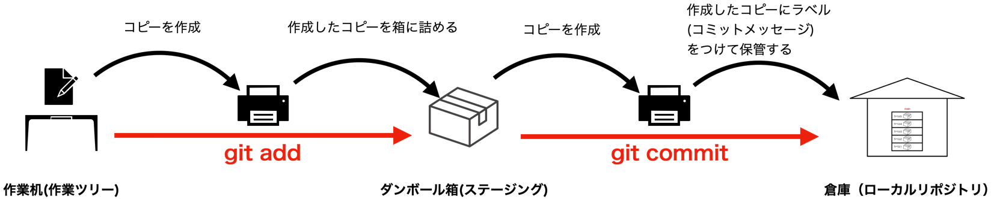


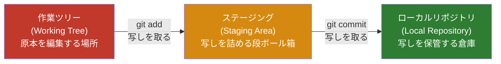

| エリア | これは何か | たとえると |
|---|---|---|
| **作業ツリー** | いま自分が開いて編集している**フォルダの中身そのもの** | 原本の書類を広げた作業机の上 |
| **ステージング** | `git add` で指定したファイルの**写しを詰めておく箱** | コミット1回分の段ボール箱 |
| **ローカルリポジトリ** | 箱にラベルを貼って保管する場所（`.git` フォルダの中） | 箱を保管する倉庫 |

「作業ツリー」「ステージング」と言われてもピンとこないと思いますので、1つずつ具体的に見ていきます。

### 作業ツリー＝いま使っているフォルダそのもの

作業ツリー（Working Tree）は、**あなたが今ファイルを編集している、そのフォルダの中身そのもの**です。特別な場所ではありません。

たとえば `C:\Users\yamada\myproject`（Windows）や `~/myproject`（Mac）といったプロジェクトフォルダを開いて、原稿やソースコードを書き換えて保存したり、ファイルの名前を変えたり、削除したりしますよね。その**エクスプローラーやFinderで見えている状態**が作業ツリーです。3つのエリアのうち、**目で見て触れるのはここだけ**です。

> ⚠️ **作業ツリーで編集して保存しただけでは、Gitはまだ何も記録していません。** 「ファイルを保存する」ことと「Gitに履歴として残す」ことは別の操作です。履歴に残すには、この後の `git add` と `git commit` が必要です。

### ステージングエリア＝addしたものを詰める箱

ステージングエリア（Staging Area）は、**`git add` で指定したファイルやフォルダの写し（コピー）を詰めておく箱**です。「次のコミットに何を含めるか」を、この箱の中で組み立てます。

- **入るのは写し（コピー）です。** 原本は作業ツリーに残ったままなので、`git add` しても作業ツリーのファイルが消えたり移動したりはしません。
- **入るのは `git add` した瞬間の状態です。** `git add` した後にさらに編集しても、箱の中身は古いまま更新されません。編集し直したら、もう一度 `git add` して箱に入れ直します。
- **何を入れるかは自分で選べます。** 10個のファイルを編集していても、`git add` で3個だけ指定すれば、箱に入るのはその3個だけです。

> 💡 **なぜわざわざ箱を経由するのか？** 「機能Aの修正」と「誤字の直し」を同時に作業してしまったとき、箱があれば片方だけを選んで記録できるからです。1つのコミットに関係のない変更が混ざらないので、後から履歴を読み返しやすくなります。全部まとめて入れたいときは `git add .` で一括指定できます。

### ローカルリポジトリ＝ラベル付きの箱をしまう倉庫

`git commit` を実行すると、箱の中身に**ラベル**（コミットメッセージ＝「何のための変更か」の説明。加えて、誰が・いつ変更したかも自動で記録されます）を貼って、倉庫にしまいます。この倉庫がローカルリポジトリで、その実体はプロジェクトフォルダの中にある `.git` という**隠しフォルダ**です。

- 倉庫にしまわれたラベル付きの箱、これが**1つのコミット**です。しまった箱は勝手に消えないので、**いつでもその時点の状態を取り出せます**（＝過去に戻れる）。
- 箱は倉庫に**しまった順に一列に**並んでいきます。だから後から「いつ・何を・なぜ変えたか」を順にたどれます。
- **「ローカル」は「自分のパソコンの中」という意味**です。`git commit` した時点では、まだ自分のPCの中に保管されているだけで、インターネット上のGitHub（リモートリポジトリ）には届いていません。共有するには『GitHub編』で扱う `git push` が必要です。

> ⚠️ `.git` フォルダは倉庫そのものです。**手で開いて中身を編集したり、削除したりしないでください。** 削除すると、そのプロジェクトの履歴がすべて失われます。

### 3つのエリアのまとめ

ポイントは、`git add` も `git commit` も「**写し（コピー）を取って次の場所に置く**」操作だという点です。**元のエリアには元のまま残る**ので、先に進めても空になりません。

- `git add`：机の上の原本の**写しを取って**箱に入れる（原本は机に残る）
- `git commit`：箱の中身の**写しを取って**倉庫に保管する（箱の中身も残る）

> **補足**：`add` や `commit` をしても、**元のエリアが空になって消えることはありません**。どちらも「元を運び出す」のではなく「**写しを取って次に置く**」操作だからです。Gitは各エリアが「その時点の写し（スナップショット）」を持つように動くため、コミットは**差分ではなくスナップショット**として記録されます。

つまり基本操作は **「編集する → `add` で写しを詰める → `commit` で写しを保管する」** の繰り返しです。本書ではこの流れを**黄金フロー**と呼びます。この3ステップが分かれば、Gitの8割は理解できたようなものです。

---

## Gitのインストール

お使いのPCのOSに合わせて進めてください。インストールが終わったら、ターミナルで次を実行し、バージョンが表示されれば成功です。

```bash
git --version
# 出力例: git version 2.45.0
```

### Windows

Windowsでは「Git for Windows」をインストールします。これには **Git Bash** という、macOS/Linux風のコマンドが使えるターミナルが付いてきます。本手引書のWindowsの説明はこの Git Bash を使う前提です。

1. 下記URLからインストーラをダウンロードします。
   [Git - Downloading Package](https://git-scm.com/download/win)
2. ダウンロードしたインストーラをダブルクリックして起動します。

以下、インストーラの選択画面を順に説明します。

> 💡 **基本はどの画面もデフォルトのまま「Next」で進めて問題ありません。** 以下では、特に選択に注意したい画面を中心に説明します。

**1. 「Next」をクリックする**

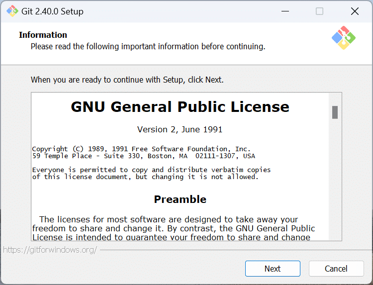

**2. インストール先フォルダを選択する**（特に問題がなければデフォルトのまま「Next」）

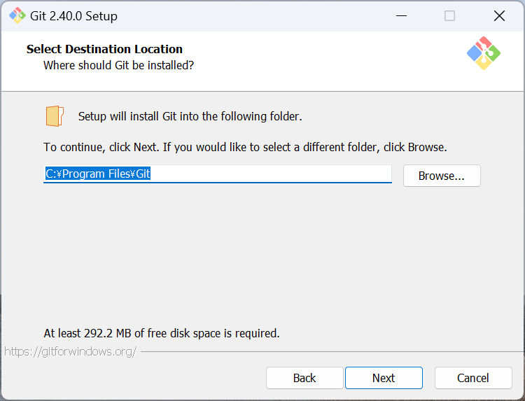

**3. インストールするコンポーネントを選択する**（研究用途では追加不要なのでデフォルトのまま「Next」）

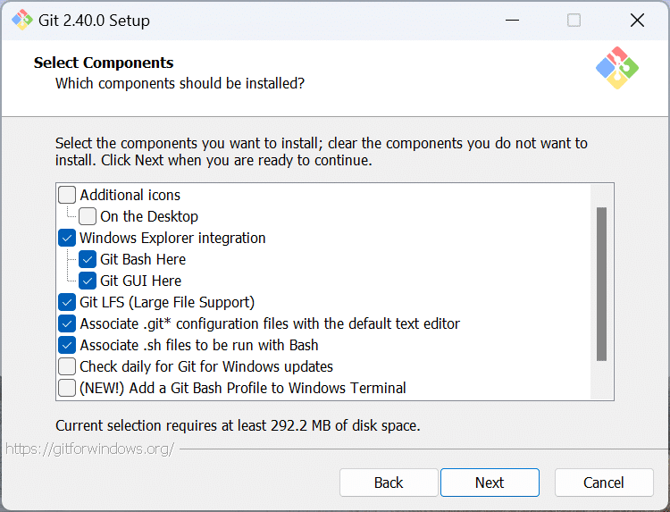

各項目の意味（参考）:

| 項目 | 意味 |
|---|---|
| Additional icons → On the Desktop | デスクトップにGitアイコンを置くか |
| Windows Explorer integration | 右クリックメニューからGit Bash/GUIを使えるようにするか |
| Git LFS | 動画・画像など大きなファイルを扱えるようにするか |
| Associate .git* configuration files… | `.git`で始まる設定ファイルを既定のエディタに関連付けるか |
| Associate .sh files… | `.sh`ファイルをGit Bashで実行するか |
| Check daily for Git for Windows updates | 毎日アップデートを確認するか |
| Add a Git Bash Profile to Windows Terminal | Windows TerminalでGit Bashを使えるようにするか |

**4. スタートメニューに表示する名前を決める**（デフォルトのまま「Next」）

> 💡 「スタートメニュー」とは、画面左下の Windows アイコンをクリックすると開く、アプリの一覧のことです。

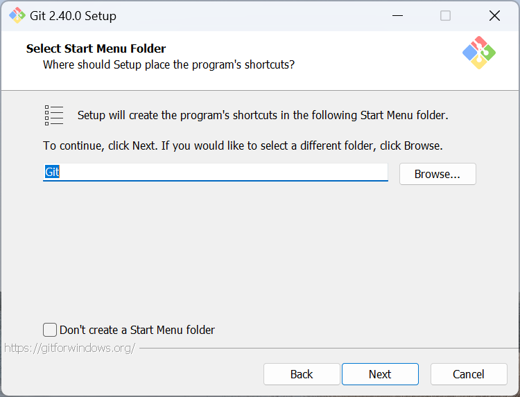

**5. 既定のエディタを選択する**

デフォルトはVimですが、不慣れだと操作が難しいため、**VS Codeを使う予定なら「Use Visual Studio Code as Git's default editor」を選択**します。

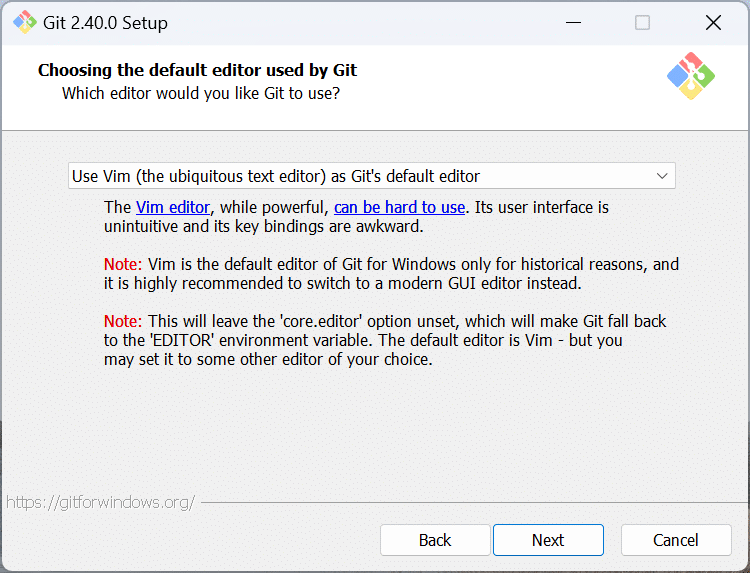

**6. 新規リポジトリの初期ブランチ名を指定する**

**「Override the default branch name…」を選び、`main` と入力する**のがおすすめです（世界的に `main` が標準）。こだわりがなければ「Let Git decide」でも構いません。

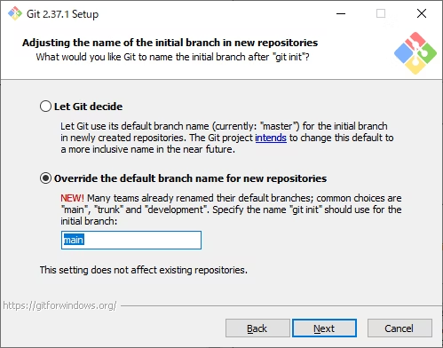

**7. 環境変数（PATH）を設定する**（デフォルトのまま「Next」）

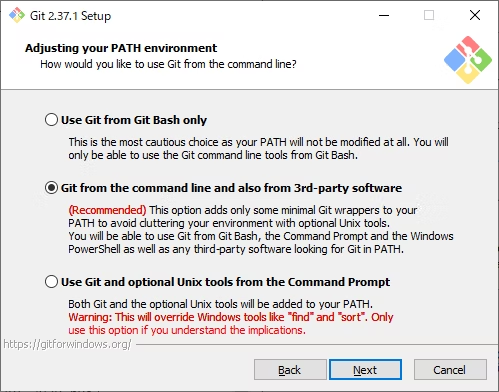

**8. SSH実行ファイルを選択する**（外部のSSHを使う特別な理由がなければデフォルト「Use bundled OpenSSH」のまま「Next」）

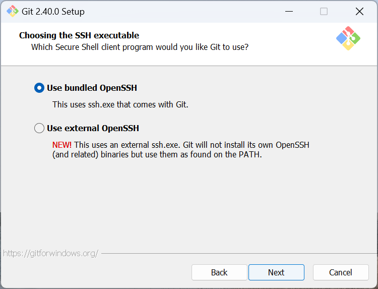

**9. HTTPS通信に使う証明書を選択する**（デフォルト「OpenSSL library」のまま「Next」で問題ありません）

将来、独自の認証局を使う企業のサーバーにアクセスする場合のみ、Windowsの証明書ストアを使う後者を選びます。

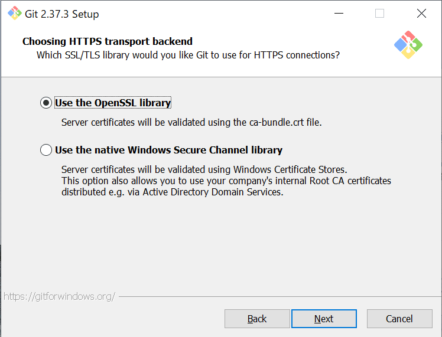

**10. 改行コードの扱いを選択する**

Windowsと他OSで改行コードが異なるため重要です。複数人・複数環境で開発するなら **「Checkout as-is, commit Unix-style line endings」** を選びます。

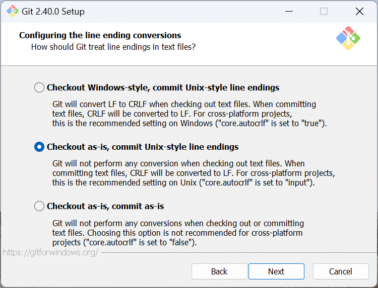

| 選択肢 | 動作 |
|---|---|
| Checkout Windows-style, commit Unix-style | 取得時CRLFに、コミット時LFに変換 |
| **Checkout as-is, commit Unix-style**（推奨） | 取得時はそのまま、コミット時のみLFに変換 |
| Checkout as-is, commit as-is | 一切変換しない |

**11. ターミナルエミュレータを選択する**（Linuxのコマンドも使える **「Use MinTTY」**（デフォルト）がおすすめ）

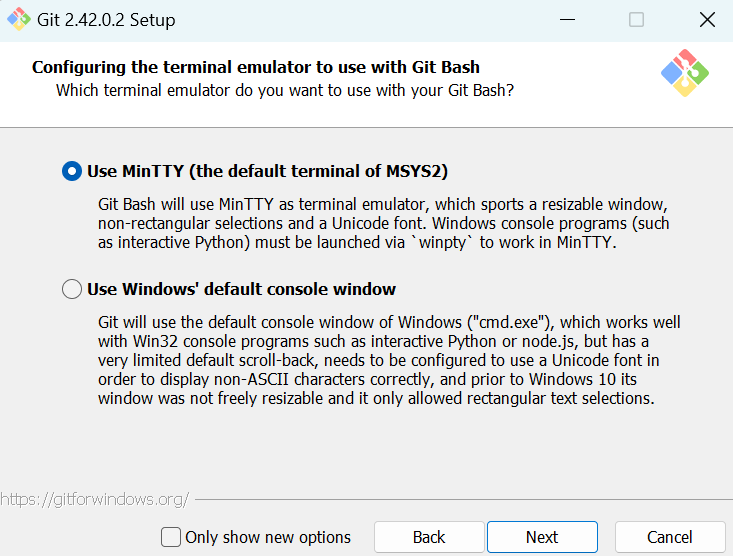

**12. `git pull` の動作を選択する**（デフォルト「Fast-forward or merge」のまま「Next」）

> 💡 `git pull` は、後の [02_GitHub編](02_GitHub編.md) で扱う「クラウド側の変更を手元に取り込むコマンド」です。ここでは意味が分からなくても問題ありません。

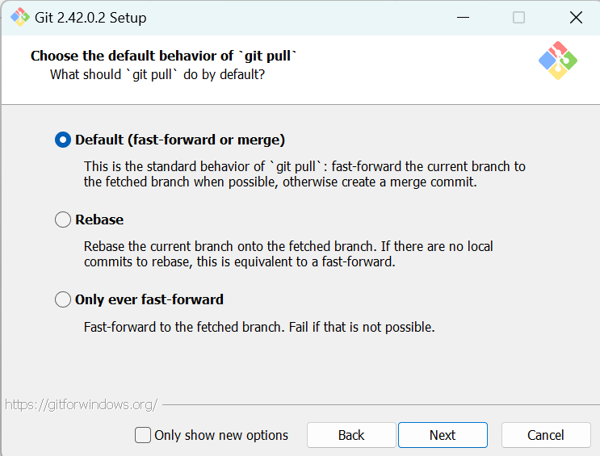

**13. 認証情報の保存方法を選択する**（デフォルトの **「Git Credential Manager」** のまま「Next」。パスワードを毎回入力せずに済みます）

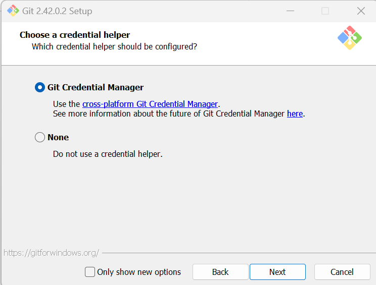

**14. 追加オプションを選択する**

**「Enable file system caching」**（高速化）にチェック。macOS等とリポジトリを共有するなら **「Enable symbolic links」** もチェックします。

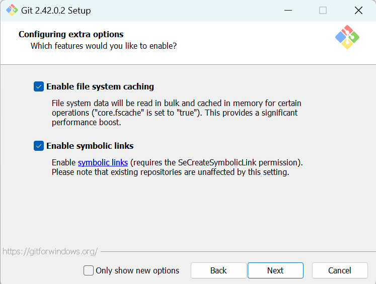

**15. 実験的オプションを確認してインストールする**（予期せぬ不具合を避けるため**何もチェックせず**「Install」をクリック）

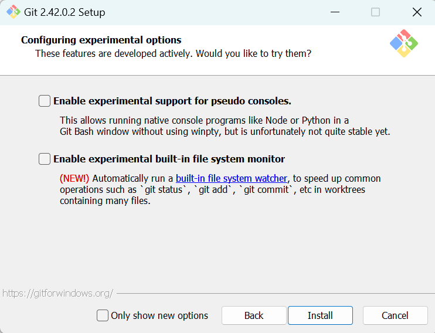

インストール後、スタートメニューから **Git Bash** を起動し、`git --version` でバージョンが出れば完了です。

### macOS

macOSには2つの方法があります。**どちらか一方**でOKです。

**方法A: Xcode Command Line Tools（最も手軽）**

ターミナル（`アプリケーション > ユーティリティ > ターミナル.app`）を開き、次を実行します。Gitを含む開発ツール一式が入ります。

```bash
xcode-select --install
```

ダイアログが出たら「インストール」をクリックします。

**方法B: Homebrew（最新版を使いたい場合）**

[Homebrew](https://brew.sh/index_ja) が入っていれば、次で最新のGitが入ります。

```bash
brew install git
```

どちらの場合も、ターミナルで `git --version` を実行してバージョンが表示されれば完了です。

### Linux

Linuxでは、お使いの**ディストリビューション**（Ubuntu、Fedora など Linux の種類）に付属する**パッケージマネージャ**（ソフトを導入・管理する仕組み）を使います。自分の環境に合うものを1つ選んで実行します。

```bash
# Debian / Ubuntu 系
sudo apt update && sudo apt install git

# Fedora / RHEL 系
sudo dnf install git

# Arch 系
sudo pacman -S git
```

端末（ターミナル）で `git --version` を実行してバージョンが表示されれば完了です。

---

## 最初の設定

インストール直後に**一度だけ**行う設定です。コミットに記録される「あなたの名前とメールアドレス」を登録します。ここで設定した名前・メールが、後でGitHub上の履歴にも表示されます。

ターミナル（Windowsは Git Bash）を開き、次を順に実行します。

```bash
# あなたの名前を登録（GitHubのアカウント名に合わせるのがおすすめ）
git config --global user.name "your-name"

# あなたのメールアドレスを登録（GitHubで使う予定のメール）
git config --global user.email "you@example.com"

# 設定内容を確認する
git config --global --list
```

> ⚠️ 名前やメールにスペースが含まれる場合は、上のように **ダブルクォート `"` で囲んでください**。

`--global` は「このPC全体の共通設定」という意味です。一度やれば、以降すべてのリポジトリに適用されます。

> 💡 おすすめの追加設定（初期ブランチ名を `main` に統一）
> ```bash
> git config --global init.defaultBranch main
> ```

---

## 【実践】はじめてのコミット

ここが本番です。先ほどの**黄金フロー（編集 → `add` → `commit`）**を、実際に手を動かして体験します。**この通りに写経すれば、最初のコミットが作れます。** 練習用のフォルダで試してみましょう。

### ステップ0：作業フォルダを用意して移動する

```bash
# 練習用フォルダを作って中に入る
mkdir git-practice
cd git-practice
```

> 💡 `cd`（change directory）はフォルダを移動するコマンドです。以降の操作は「今いるフォルダ」に対して行われます。

### ステップ1：リポジトリを作る（git init）

```bash
git init
```

これで今のフォルダに `.git` という隠しフォルダが作られ、Gitでの管理が始まります。**これが、あなたのPCの中の「ローカルリポジトリ」**です。`.git` の中に履歴（コミット）が保存されます（中身を直接触る必要はありません）。

```bash
# git initに成功すると、次のように表示されます
hoge@n171h100 git-practice % git init
Initialized empty Git repository in /Users/hoge/git-practice/.git/
```


> `git init` 後にフォルダ内へ `.git` フォルダができた様子（Windowsはエクスプローラで隠しファイル表示ON、macOSは Finder で `Cmd+Shift+.`、Linuxはファイルマネージャで隠しファイル表示）。
>
> 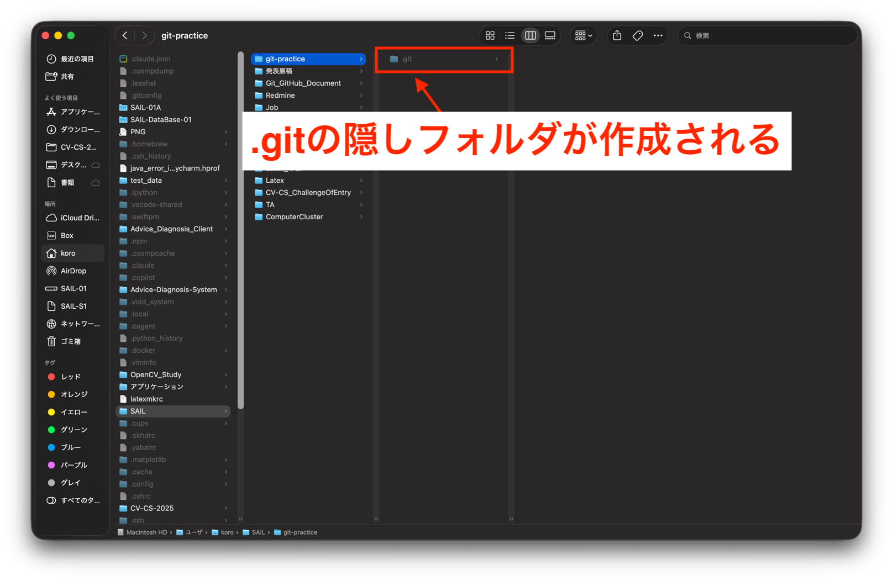

### ステップ2：ファイルを作る

試しにテキストファイルを1つ作ります。

```bash
echo "Hello Git" > hello.txt
```

### ステップ3：変更を確認する（git status）

```bash
git status
```

`hello.txt` が「Untracked files（まだ管理されていないファイル）」として赤色で表示されます。

> `git status` の出力画面
> 
> 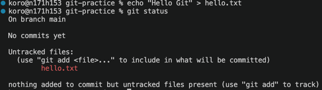

### ステップ4：ステージングに追加する（git add）

```bash
git add hello.txt
```

これで `hello.txt` が「次のコミットに含める変更」として選ばれました。もう一度 `git status` を実行すると、今度は緑色で表示されます。

> `git add` 後の `git status` の出力画面
> 
> 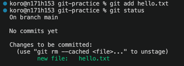

### ステップ5：コミットする（git commit）

```bash
git commit -m "最初のコミット"
```

`-m` の後ろの文字列が**コミットメッセージ**（変更内容の一言メモ）です。これでコミット（セーブポイント）が1つ作られました。

### ステップ6：履歴を確認する（git log）

```bash
git log
```

> `git log` の出力画面
> 
> 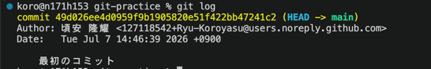

今作ったコミットが、作成者・日時・メッセージとともに表示されます。`q` キーで表示を終了します。

### 黄金フローのまとめ

上の**ステップ4（`git add`）→ ステップ5（`git commit`）**が、この黄金フローの中核です。図にすると、次の3つの繰り返しになります。


実際の作業は、この **「編集 → add → commit」** をひたすら繰り返すだけです。

```bash
# 日常的に使う最小セット
git add .                       # 変更した全ファイルをステージングに追加
git commit -m "変更内容のメモ"   # コミットとして記録
```

> 💡 `git add .` の `.`（ドット）は「今いるフォルダ以下のすべての変更」という意味です。

---

## 状態を確認するコマンド

Gitは「今どういう状態か」をこまめに確認しながら使うのが安全です。困ったらまず `git status` を打つ癖をつけましょう。

| コマンド | 何が分かるか |
|---|---|
| `git status` | どのファイルが変更され、どのエリアにあるか |
| `git log` | これまでのコミット履歴（作成者・日時・メッセージ） |
| `git log --oneline` | コミット履歴を1行ずつ簡潔に表示 |
| `git diff` | まだステージングしていない変更の中身（どこを書き換えたか） |
| `git diff --staged` | ステージング済みの変更の中身 |

このうち **`git diff`** は「どこをどう書き換えたか」を確認するのに特によく使います。実際に実行してみましょう。

```bash
git diff
```

`git diff` では、追加された行が `+` 付きの緑、削除された行が `-` 付きの赤で表示されます。

> `git log` と `git diff` の出力画面（差分の色分けが分かるもの）。
> 
> 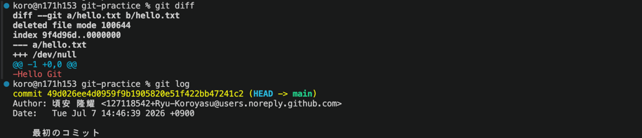

> `git add` でステージングに追加した後は、`git diff` では何も表示されなくなります。ステージング済みの変更を確認するには `git diff --staged` を使います。
> 
> 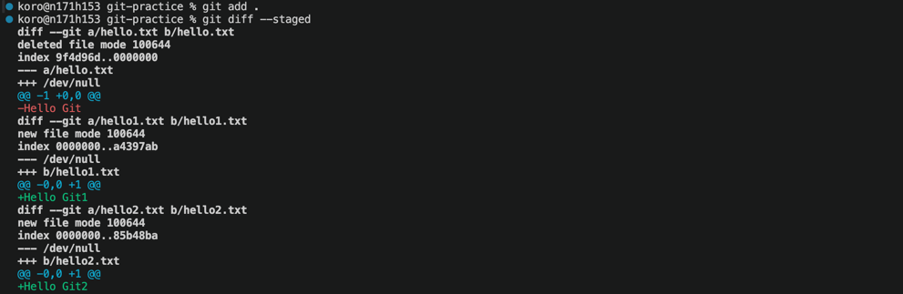

> `git commit` でコミットした後は、`git diff` でも `git diff --staged` でも何も表示されなくなります。コミット済みの変更を確認するには `git log` を使います。
> 
> 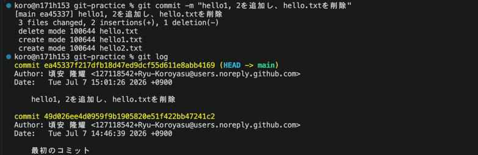

---

## .gitignore：記録したくないファイルを除外する

プロジェクトには「Gitで記録（コミット）したくないファイル」があります。たとえば次のようなものです。

- パスワードやAPIキーなどの**秘密情報**（誤って公開すると危険なので、そもそも記録しない）
- 自動生成される一時ファイル（`.DS_Store`、`__pycache__/`、LaTeXの `.aux` `.log` など。**元から作り直せる**ので記録する意味がない）
- サイズの大きいデータやビルド成果物（**リポジトリが重くなる**うえ、GitHubにはアップロードできる容量の上限もある。これらも必要なときに生成し直せることが多い）

これらは `.gitignore` というファイルに書いておくと、Gitが**最初から無視**してくれます（`git status` にも出てこなくなります）。

リポジトリの一番上の階層に `.gitignore` という名前のファイルを作り、無視したいものを1行ずつ書きます。

```text
# macOS が作る隠しファイル
.DS_Store

# Python のキャッシュ
__pycache__/
*.pyc

# LaTeX の中間ファイル
*.aux
*.log
*.out

# 秘密情報（絶対にコミットしない）
.env
secrets.txt
```

> ⚠️ **重要**: 一度コミットしてしまったファイルは、後から `.gitignore` に書いても無視されません。秘密情報は**最初のコミット前**に `.gitignore` へ登録してください。

> 💡 言語やフレームワークごとの `.gitignore` テンプレートは [github/gitignore](https://github.com/github/gitignore) で公開されています。

> 💡 使用する言語やフレームワークが決まっている場合は、[Toptal](https://www.toptal.com/developers/gitignore)を使うと、必要な `.gitignore` を自動生成できます。

---

## このドキュメントのまとめ

- Gitは「いつでも戻れるセーブポイント」を作る変更履歴管理ツール
- ファイルは **作業ツリー → ステージング → ローカルリポジトリ** の3エリアへ「写し」が渡っていく（元のエリアは空にならない）
- 基本操作は **「編集 → `git add` → `git commit`」** の繰り返し
- 困ったら `git status` で現在地を確認する

次は、ここで作った履歴を**クラウド（GitHub）に上げて共有する**方法です。
→ [02_GitHub編](02_GitHub編.md) へ
