# 02. GitHub編 〜ローカルとクラウドをつなぐ〜

このドキュメントは [01_Git編](01_Git編.md) の続きです。01編では「自分のPCの中だけ」で変更を記録しました。
02編では、その記録を **GitHub（クラウド）** に置いて、バックアップ・複数PC・複数人での共有ができるようにします。

この編で扱うのは **「ローカルとGitHubをつなぎ、同期する」ところまで**です。
ブランチを分けた共同作業・プルリクエスト（PR）・コンフリクトの解決は [03_ブランチ・PR編](03_ブランチ・PR編.md) で扱います。

> 💡 **このドキュメントの読み方**
> - まず一度つないでみたい人 → 「アカウントを作る」→「認証を設定する」→「リモートリポジトリを用意する」→「つなぐ」を順に写経
> - コマンドをド忘れした人 → [05_逆引きチートシート](05_逆引きチートシート.md) へ
> - エラーが出て困った人 → [04_トラブルシューティング編](04_トラブルシューティング編.md) へ

---

## 目次

1. [そもそもGitHubとは](#そもそもgithubとは)
2. [ローカルとリモートの全体像](#ローカルとリモートの全体像)
3. [GitHubアカウントを作る](#githubアカウントを作る)
4. [認証を設定する（HTTPS と SSH）](#認証を設定するhttps-と-ssh)
5. [リモートリポジトリを用意する](#リモートリポジトリを用意する)
6. [ローカルとリモートをつなぐ](#ローカルとリモートをつなぐ)
7. [アップロードする（push）](#アップロードするpush)
8. [ダウンロードする（pull と fetch）](#ダウンロードするpull-と-fetch)
9. [日常のフロー](#日常のフロー)
10. [まとめと次のステップ](#まとめと次のステップ)

---

## そもそもGitHubとは

**Git と GitHub は別物です。**

- **Git** … あなたのPCの中で動く「変更履歴を記録する道具」（01編で使ったもの）
- **GitHub** … Gitのリポジトリを**クラウド上に置いて共有できるWebサービス**

01編では、あなたのPCの中に「倉庫（ローカルリポジトリ）」を作りました。GitHubは、その**クラウド上にあるもう一つの倉庫（リモートリポジトリ）**だと考えてください。手元の倉庫の**写しをクラウドの倉庫にも置いておく**イメージです。


クラウドに置くと、こんなことができます。

- **バックアップ**：PCが壊れても、GitHubから取り戻せる
- **複数PCで共有**：研究室のPCと自宅のPCで同じ作業を続けられる
- **複数人で共有**：チームで同じリポジトリを編集できる
- **公開**：コードや手引書を世界に公開できる（このドキュメントもGitHub上にあります）

> 💡 「リモート（remote）」は**手元から離れた場所＝クラウド側**、「ローカル（local）」は**あなたのPCの中**を指す言葉です。以降ずっと出てくるので覚えておいてください。

---

## ローカルとリモートの全体像

ローカルとリモートの間で写しをやり取りするコマンドは、主に次の4つです。**向き（アップロードかダウンロードか）**で整理すると分かりやすいです。

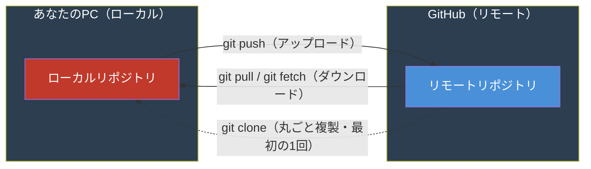

| コマンド | 向き | 何をするか |
|---|---|---|
| `git clone` | リモート → ローカル | リモートの倉庫を**丸ごと手元に複製**する（最初の1回だけ） |
| `git push` | ローカル → リモート | 手元のコミットを**クラウドへアップロード**する |
| `git fetch` | リモート → ローカル | クラウドの最新を**取得するだけ**（手元の作業には反映しない） |
| `git pull` | リモート → ローカル | クラウドの最新を**取得して手元に反映**する（`fetch` + 統合） |

> 💡 `git add` / `git commit`（01編）は**ローカルの中だけ**の操作でした。GitHubと通信するのは、この `clone` / `push` / `fetch` / `pull` のときだけです。

---

## GitHubアカウントを作る

まだアカウントがなければ作成します。

1. [https://github.com/](https://github.com/) を開き、**「Sign up」** をクリックします。
2. メールアドレス・パスワード・ユーザー名を入力して進めます。
3. 登録したメールアドレスに届く確認コードを入力すれば完了です。

> 💡 ここで登録する**メールアドレスは、01編の `git config --global user.email` で設定したものに揃える**のがおすすめです。揃えておくと、コミットとGitHubアカウントが正しく結びつきます。

---

## 認証を設定する（HTTPS と SSH）

GitHubに `push`（アップロード）するときは、「本当にあなたか」を確認する**認証**が必要です。方式は主に2つあり、**どちらか一方**を設定すればOKです。

| 方式 | URLの形 | 特徴 |
|---|---|---|
| **HTTPS** | `https://github.com/ユーザー名/リポジトリ.git` | **GitHub CLI（`gh`）でログインするだけ**で使えて最も手軽。トークンの手動管理も可能 |
| **SSH鍵** | `git@github.com:ユーザー名/リポジトリ.git` | 鍵を1度登録すれば以降は認証不要。複数リポジトリで使い回せる |

> 💡 迷ったら、まずは手軽な **HTTPS** で始めて構いません。HTTPSは、後述の **GitHub CLI（`gh`）でログインするだけ**で使えるようになり、トークンを自分で発行・管理する必要がありません。頻繁に使うようになったら SSH に移行しても快適です。

### 方式A：HTTPS

HTTPSでの認証には2通りあります。**GitHub CLI（`gh`）を使う方法が圧倒的に手軽**なので、こちらを最初におすすめします。トークンを手作業で扱いたい場合のために、従来のPAT方式も後に載せます。

#### A-1（おすすめ）：GitHub CLI（`gh`）でログインする

**GitHub CLI（`gh`）** はGitHubを操作する公式コマンドです。これで一度ログインしておくと、`gh` がGitの認証を裏で肩代わりしてくれるため、**トークンを自分で発行しなくても `push` / `pull` がそのまま通ります**。

**手順1：`gh` をインストールする**

> ⚠️ **`gh` はGit本体には含まれていません。** 01編でGitをインストールしても `gh` は入っていないので、**最初に別途インストールが必要**です。まず `gh --version` を実行し、`command not found`（未インストール）なら下記でインストールしてください。

```bash
# macOS（Homebrew）
brew install gh

# Windows（winget）
winget install --id GitHub.cli

# Linux（Debian / Ubuntu 系）
sudo apt install gh
```

インストール後、次でバージョンが表示されれば成功です。

```bash
gh --version
# 出力例: gh version 2.62.0 (2024-11-27)
```

> 💡 他の環境やうまくいかない場合は、公式手順 [cli.github.com](https://cli.github.com/) を参照してください。

**手順2：ログインする**

```bash
gh auth login
```

対話形式で聞かれるので、次のように選びます。

> 💡 質問文や順序、選択肢の文言は **`gh` のバージョンによって変わることがあります**。下記の画面例と完全に一致しなくても、**同じ意味の選択肢**（GitHub.com／HTTPS／ブラウザでログイン など）を選べば問題ありません。

1. **What account do you want to log into?(認証するアカウントの選択)**
```bash
# GitHub.com を選択する
hoge@n171h184 Git_GitHub_Document % gh auth login
? Where do you use GitHub?  [Use arrows to move, type to filter]
> GitHub.com
  Other
```
2. **What is your preferred protocol for Git operations?(認証方式の選択)**
```bash
# HTTPS を選択する
? What is your preferred protocol for Git operations?[Use arrows to move, type to filter]
> HTTPS
  SSH
```
3.  **Authenticate Git with your GitHub credentials?(Gitの認証をGitHubの資格情報で行うか)**
```bash
# Yを入力する
Authenticate Git with your GitHub credentials? (Y/n) Y
```
4. **How would you like to authenticate?(認証方法の選択)**
```bash
# Login with a web browser を選択する
? How would you like to authenticate? [Use arrows to move, type to filter]
> Login with a web browser
  Paste an authentication token

# Login with a web browser を選ぶと以下のようなメッセージが出ます。
# このメッセージが出た後にEnterを押すとブラウザが開き、GitHubにログインして認証できます。
? How would you like to authenticate GitHub CLI? Login with a web browser

! First copy your one-time code: FDAC-FFFB #←認証用のワンタイムコード
Press Enter to open https://github.com/login/device in your browser... 
```

> Enter押下の後に開くブラウザ画面
> 
> **Continue**を押す。
>
> 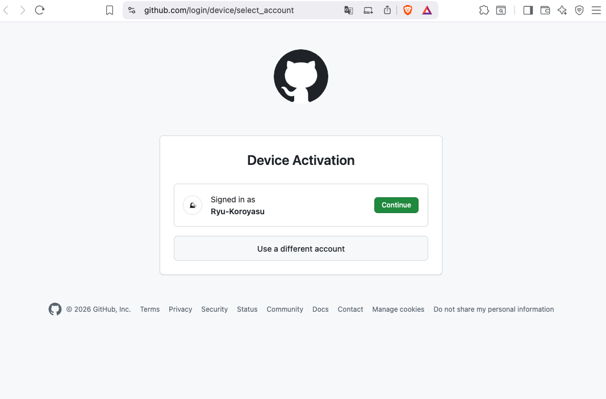
>
> Continue押下の後に表示されるブラウザ画面
> 
> ワンタイムコードを入力して **Continue** を押す。
> 
> 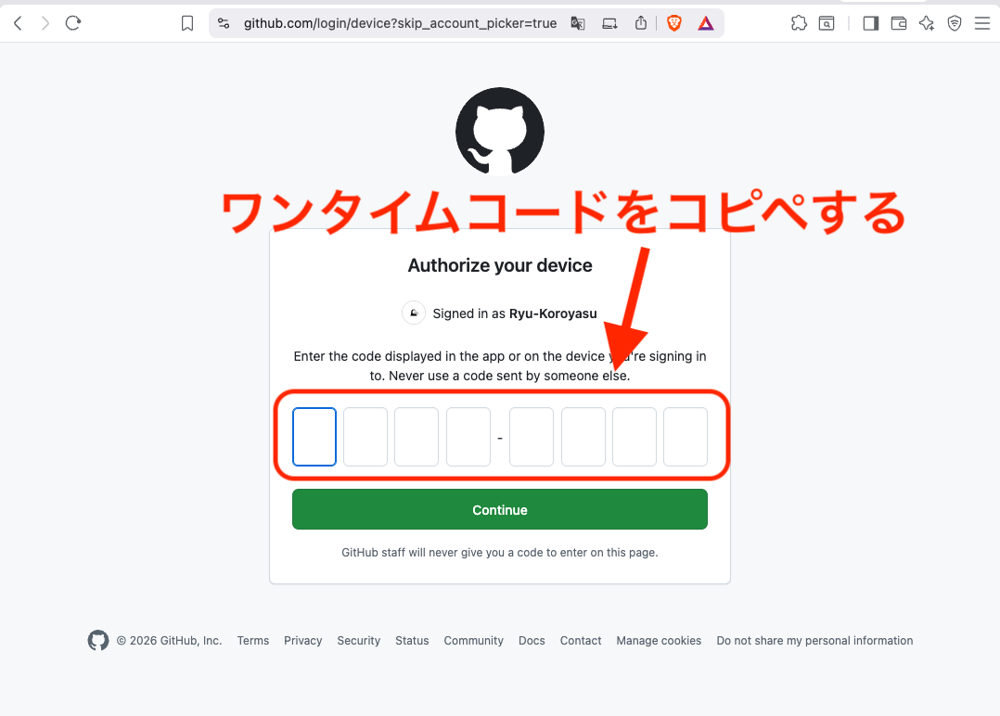

これで完了です。`gh` がGitの認証情報ヘルパーとして登録され、**以降 `git push` / `git pull` で認証を聞かれなくなります**。トークンの発行・保管は `gh` が肩代わりしてくれるため、自分で発行・管理する必要はありません。

> ⚠️ ただし `gh` が**自動で無期限に更新してくれるわけではありません**。トークンの有効期限が切れたり、GitHub側でアクセスを取り消したり、新しい権限（スコープ）が必要になった場合は、再度 `gh auth login`（権限追加なら `gh auth refresh`）で認証し直してください。`gh auth status` で現在の状態を確認できます。

```bash
# ログイン状態を確認する
gh auth status
```

> 💡 この方法なら、次章以降の「トークンを発行する」手順は不要です。**基本はこの `gh auth login` だけで済みます。**

#### A-2（手動）：パーソナルアクセストークン（PAT）を使う

`gh` を使わずHTTPSで `push` すると、ユーザー名とパスワードを聞かれます。ここで、**GitHubのログインパスワードは使えません**。代わりに **パーソナルアクセストークン（PAT）** という専用の文字列を発行して使います。

**トークンの発行手順**

1. GitHubにログインし、右上のアイコン →**Settings** を開きます。
2. 左メニュー最下部の **Developer settings** をクリックします。
3. **Personal access tokens** → **Tokens (classic)** →**Generate new token (classic)** を選びます。
4. 次を設定して発行します。
   - **Note**：用途のメモ（例：`my-laptop`）
   - **Expiration**：有効期限（例：90 days）
   - **Select scopes**：`repo` にチェック（リポジトリの読み書きに必要）
   >トークン作成画面
   > 
   > 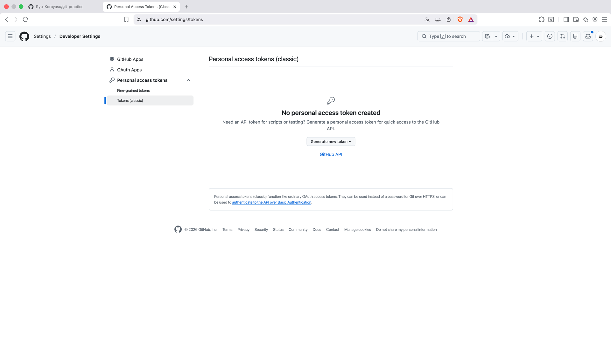
   >
   > 作成するトークンの設定
   > 
   > 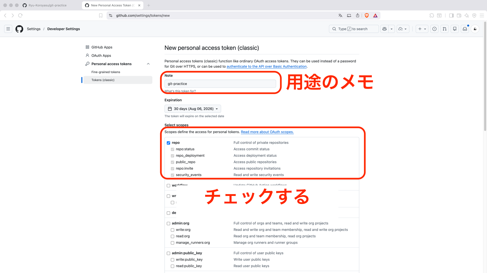
5. **Generate token** を押すと、`ghp_xxxx…` という文字列が表示されます。
   > トークン発行画面。
   > 
   > 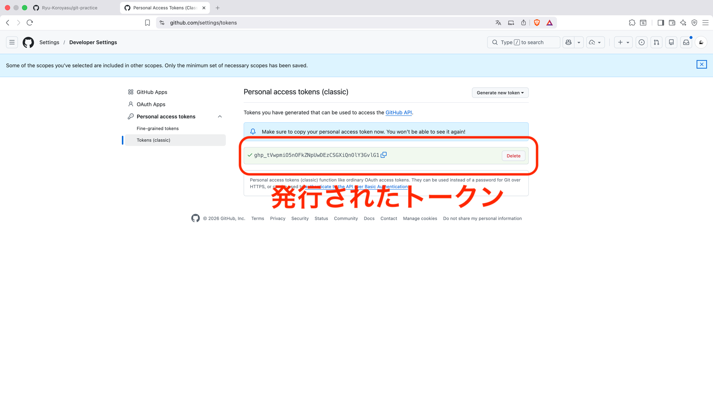

> ⚠️ **トークンは発行直後の1回しか表示されません。** その場でコピーし、パスワードマネージャ等に保管してください。画面を閉じると二度と確認できず、再発行が必要になります。

**トークンの使い方**

`push` 時にユーザー名とパスワードを聞かれたら、**パスワードの欄に、先ほどのトークンを貼り付けます**。

```text
Username: your-github-name
Password: ghp_xxxxxxxxxxxxxxxxxxxx   ← ログインパスワードではなくトークンを入力
```

一度入力すればトークンが記憶されるので、次回以降は入力不要になります。

### 方式B：SSH鍵

SSHは、**鍵ペア（秘密鍵と公開鍵）**を使う方式です。公開鍵をGitHubに登録しておくと、以降は認証情報の入力なしで `push` できます。

**手順1：鍵ペアを作る**

ターミナル（WindowsはGit Bash）で次を実行します。メールアドレスはGitHubのものにします。

```bash
ssh-keygen -t ed25519 -C "you@example.com"
```

- 保存先を聞かれたら、そのまま **Enter**（デフォルトの `~/.ssh/id_ed25519` に保存されます）
- パスフレーズは、設定してもしなくても構いません（設定するとより安全）

これで秘密鍵 `id_ed25519` と公開鍵 `id_ed25519.pub` の2つが `~/.ssh/` に作られます。

> ⚠️ **秘密鍵（`.pub` が付かない方）は絶対に他人に渡さないでください。** GitHubに登録するのは公開鍵（`.pub` が付く方）だけです。

**手順2：公開鍵の中身をコピーする**

```bash
# macOS
pbcopy < ~/.ssh/id_ed25519.pub

# Windows（Git Bash）
cat ~/.ssh/id_ed25519.pub | clip

# Linux（表示された内容を手動でコピー）
cat ~/.ssh/id_ed25519.pub
```

**手順3：GitHubに公開鍵を登録する**

1. GitHubの **Settings** → **SSH and GPG keys** を開きます。
2. **New SSH key** をクリックします。
3. **Title** に分かりやすい名前（例：`my-laptop`）、**Key** に手順2でコピーした内容を貼り付けます。
4. **Add SSH key** で登録完了です。

**手順4：接続を確認する**

```bash
ssh -T git@github.com
```

次のように表示されれば成功です（`yes` を求められたら `yes` と入力）。

```text
Hi your-github-name! You've successfully authenticated, but GitHub does not provide shell access.
```

> SSH and GPG keys の New SSH key 登録画面。
> 
> 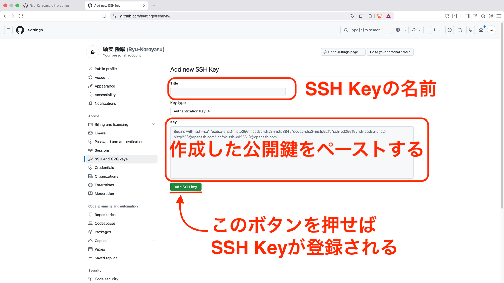

---

## リモートリポジトリを用意する

GitHub上に、写しを置くための空の倉庫（リモートリポジトリ）を作ります。

1. GitHub右上の **「+」** → **New repository** をクリックします。
2. 次を設定します。
   - **Repository name**：リポジトリ名（例：`git-practice`）
   - **Public / Private**：公開するか非公開か（研究用途なら通常 **Private**）
   - **Add a README file**：**チェックしない**（後述のパターンBで既存ローカルをつなぐ場合、付けると手順が増えるため）
3. **Create repository** をクリックします。

作成後の画面に、`https://github.com/...` や `git@github.com:...` で始まる**リポジトリのURL**が表示されます。次の手順で使うのでこの画面を開いたままにしておきます。

> **New repository の設定画面**
> 
> リポジトリの作成
> 
> 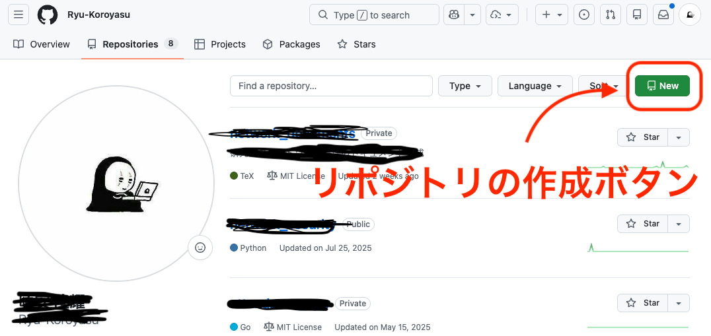
> 
> 作成するリポジトリの設定
> 
> 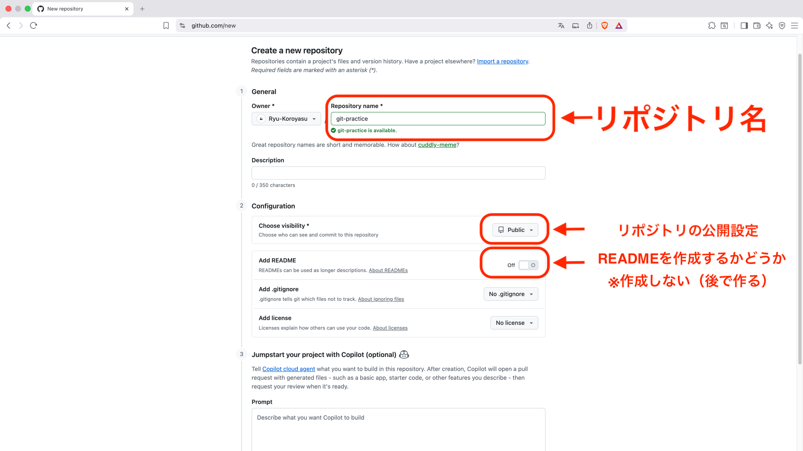
> 
> リポジトリの作成
> 
> 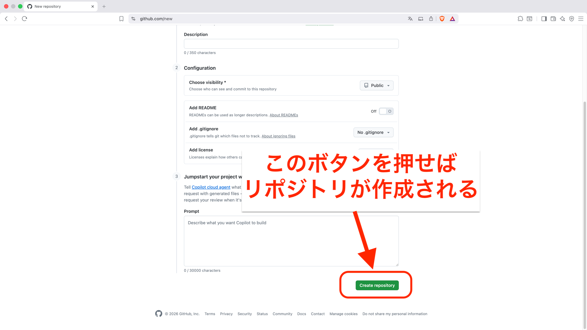

---

## ローカルとリモートをつなぐ

つなぎ方は、状況によって2パターンあります。

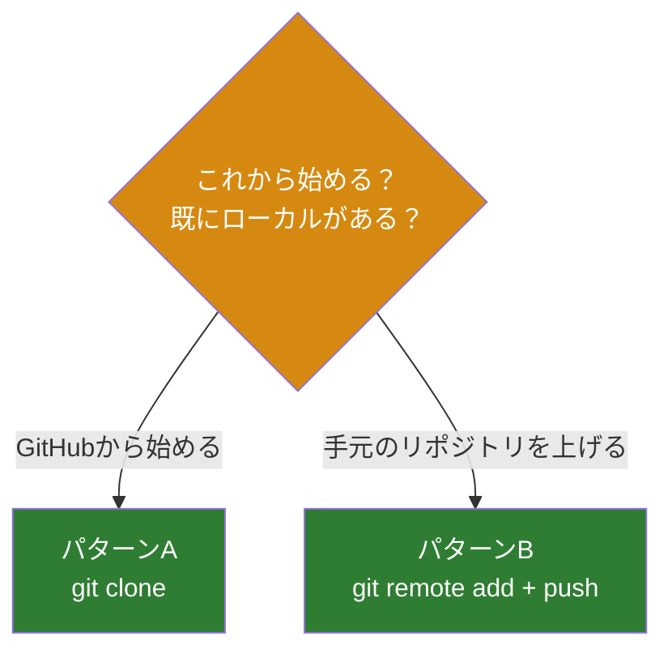

### つなぐ前に：リポジトリのURL（リンクパス）を取得する

どちらのパターンでも、`git clone` や `git remote add` に渡す**リポジトリのURL**が必要です。このURLは**GitHubのリポジトリ画面から取得**します。取得場所は、リポジトリが空かどうかで少し変わります。

**ケース1：中身のあるリポジトリ（`clone` する場合など）**

リポジトリのトップ画面にある緑色の **「＜＞ Code」** ボタンをクリックします。開いたパネルで **HTTPS / SSH** のタブを選ぶと、それぞれのURLが表示されます。右側のコピーアイコンで丸ごとコピーできます。

- **HTTPS** タブ → `https://github.com/ユーザー名/リポジトリ.git`
- **SSH** タブ → `git@github.com:ユーザー名/リポジトリ.git`

> **「Code」ボタンからURLを取得する**
> 
> 緑色の「Code」ボタンをクリックし、HTTPS / SSH タブを切り替えてURLをコピーする
> 
> httpsのURLを取得
> 
> 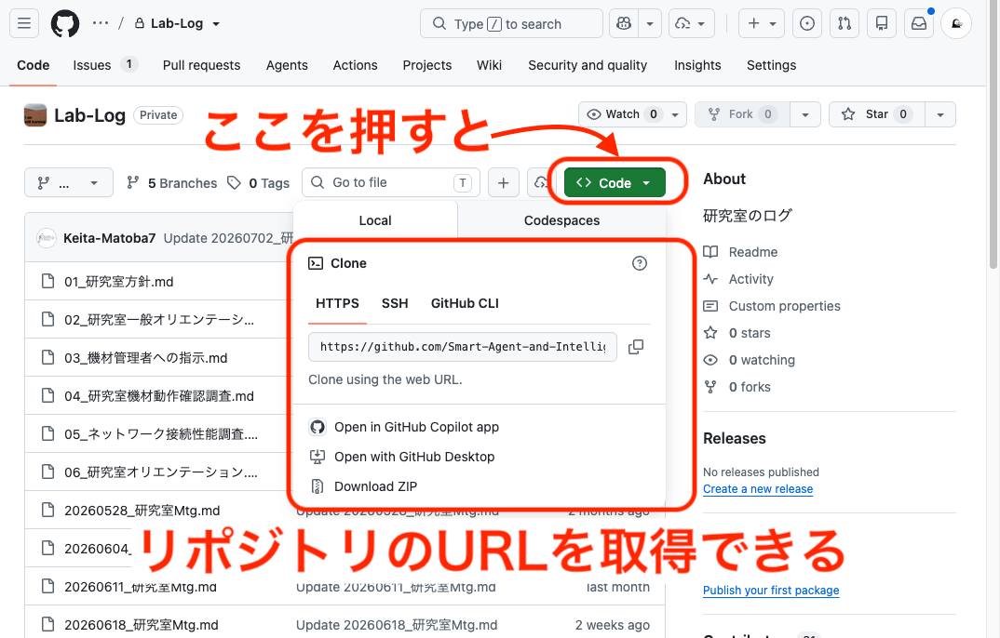
>
> sshのURLを取得
>
> 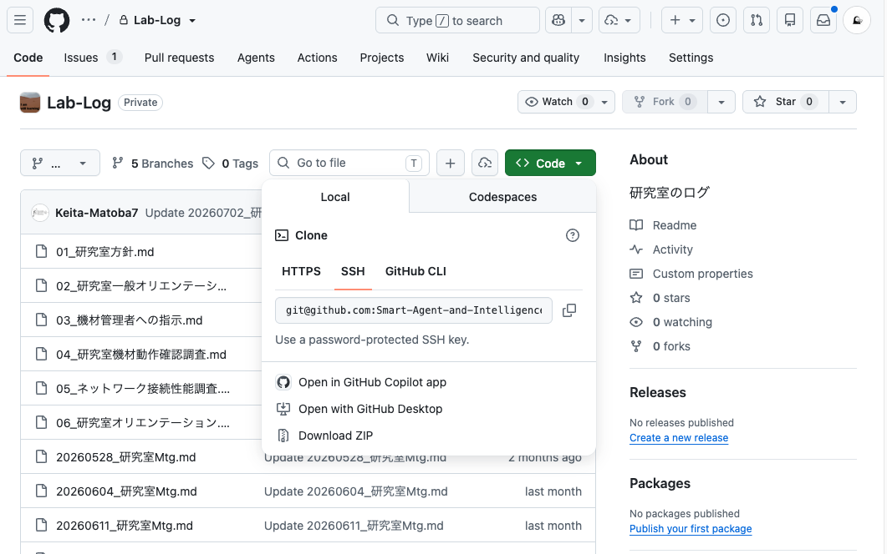

**ケース2：作りたてで空のリポジトリ（パターンBでつなぐ場合）**

「リモートリポジトリを用意する」で README を付けずに作った直後は、**「Quick setup」** の画面が表示されます。ここに表示される **HTTPS / SSH** の切り替えボタンと、その隣のURL（コピーアイコン付き）から取得します。`…or push an existing repository from the command line` の欄には、パターンBでそのまま使えるコマンドも載っています。

> **空リポジトリの Quick setup 画面**
> 
> HTTPS / SSH を切り替え、表示されたURLをコピーする
> 
> 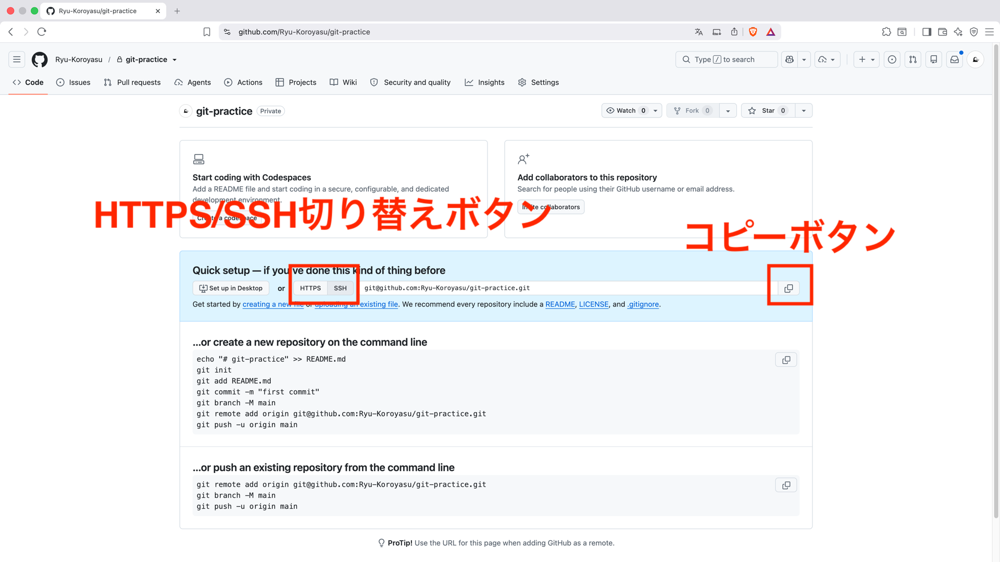

> 💡 **HTTPS と SSH のどちらのURLを使うかは、「認証を設定する」で設定した方式に合わせます。** `gh`／トークンで設定したなら HTTPS のURL、SSH鍵を登録したなら SSH のURLを選んでください。

### パターンA：GitHubで作って `git clone`（これから始める人向け）

GitHub上のリポジトリを、**丸ごと手元に複製**します。作業したいフォルダの**親フォルダ**で実行してください（`clone` するとリポジトリ名のフォルダが新しく作られます）。

```bash
# HTTPS の場合
git clone https://github.com/your-name/git-practice.git

# SSH の場合
git clone git@github.com:your-name/git-practice.git
```

複製が終わると `git-practice` フォルダが作られ、その中に入れば作業を始められます。**`origin`（リモートの登録）も自動で設定される**ので、以降はすぐ `push` / `pull` できます。

```bash
cd git-practice
git remote -v   # origin が登録されていることを確認
```

### パターンB：既存のローカルを `push`（01編で作ったものを上げる）

01編で `git init` して作った手元のリポジトリを、後からGitHubにつなぐ場合です。リポジトリのフォルダ内で実行します。

```bash
# 1. リモート（origin）を登録する
git remote add origin https://github.com/your-name/git-practice.git
#    SSH なら： git remote add origin git@github.com:your-name/git-practice.git

# 2. 登録内容を確認する
git remote -v

# 3. 現在のブランチ名を main に統一する
git branch -M main

# 4. 初回のアップロード（-u で「送り先」を覚えさせる）
git push -u origin main
```

- **`origin`** は「リモートリポジトリの標準的な別名」です。以降 URL の代わりに `origin` と書けます。
- **`-u`（`--set-upstream`）** は、`push` の引数で指定した送り先（ここでは `origin` の `main`）を、いまのローカルブランチの「既定の送り先」として覚えさせるオプションです。
  - 本来 `git push` は毎回どこへ送るか（`origin main`）を指定する必要があります。`-u` を一度付けておくと対応付けが記録され、**次回からは `git push` / `git pull` だけ**で同じ相手とやり取りできます。
  - 記録された送り先は `git branch -vv` で確認できます（ブランチ名の横に `[origin/main]` と表示されます）。

> ⚠️ `git remote add origin ...` で `error: remote origin already exists.` と出たら、既に登録済みです。URLを付け替えたいときは `git remote set-url origin <新しいURL>` を使います。

---

## アップロードする（push）

`git push` は、**ローカルリポジトリのコミット（写し）を、リモートへ送る**操作です。01編の「編集 → add → commit」でローカルに記録した内容を、クラウドへ反映します。


```bash
# 初回（-u で送り先を覚えさせる）
git push -u origin main

# 2回目以降はこれだけでOK
git push
```

`push` が終わったら、GitHubのリポジトリ画面を再読み込みしてみてください。コミットしたファイルがクラウド上に表示されているはずです。

> ⚠️ **コミットしていない変更は `push` されません。** `push` は「ローカルリポジトリにあるコミット」を送るものです。手元の編集をクラウドに反映したいときは、必ず先に `git add` → `git commit` してから `git push` します。

---

## ダウンロードする（pull と fetch）

別のPCや他の人がリモートを更新したとき、その最新を手元に取り込む（または確認する）のが `pull` と `fetch` です。

| コマンド | 動き | いつ使うか |
|---|---|---|
| `git fetch` | リモートの最新を**取得して `origin/main` に記録するだけ**（手元の `main` や作業ツリーは変えない） | 反映前に「何が来たか」を確認したいとき |
| `git pull` | `fetch` + **統合（merge）**。取得して手元の `main` にも反映 | ふだんの「最新に追いつく」操作 |

> 💡 **`origin/main` とは？** `git fetch` で取得したリモートの内容は、手元の `main` とは別の **`origin/main`** という場所に記録されます。これは「**リモートが今どうなっているかを指す、手元にあるブックマーク**」だと考えてください。だから fetch した後は、自分の作業を変えずに `git log origin/main` でリモート側の中身を確認できます。

```bash
# ふだんはこれ（取得して手元の main に反映）
git pull

# 取得だけしておいて、中身を確認してから反映したい場合
git fetch              # リモートの最新を origin/main に取得（手元の main は変わらない）
git log origin/main    # 取得した origin/main の履歴を確認
git merge origin/main  # 問題なければ手元の main に統合
```

> 💡 **作業を始める前に `git pull` する**のを習慣にすると、手元を常に最新の状態から始められ、後述のコンフリクト（衝突）が起きにくくなります。

> 💡 新しめのGit（2.27以降）では、**初めて `git pull` したときに一度だけ**「取り込み方を merge にするか rebase にするか」を設定するよう促されることがあります。迷ったら、01編と同じ標準の **merge 方式**を選ぶ次の設定を1度だけ実行しておけば、以降は聞かれません。
> ```bash
> git config --global pull.rebase false
>
> これは上流ブランチの設定（`-u`）とは別の全体設定です。一度決めれば、あとは引数なしの `git pull` / `git push` だけで同期できます。

> ⚠️ 複数人・複数PCで同じブランチを編集していると、`pull` 時に**コンフリクト**（同じ箇所を別々に変更したことによる衝突）が起きることがあります。その解決方法は [03_ブランチ・PR編](03_ブランチ・PR編.md) で詳しく扱います。

---

## 日常のフロー

GitHubとつないだ後の、毎日の基本的な流れです。**始めにpull、終わりにpush**を挟むだけで、01編の黄金フロー（編集 → add → commit）がそのまま使えます。

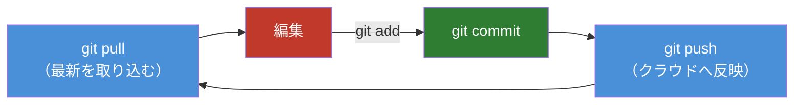

```bash
# 1. まず現在の状態を確認する（今どのファイルがどのエリアにあるか）
git status

# 2. 作業開始前に、GitHub（リモート）の最新を手元に取り込む
git pull

# 3. ファイルを編集したら、変更を記録する（01編の黄金フロー）
git add .                      # 変更をステージングに追加
git commit -m "変更内容のメモ"   # コミットとして記録

# 4. 記録した変更を GitHub（リモート）へアップロードする
git push
```

この繰り返しで、手元とクラウドが常に同期された状態を保てます。

---

## まとめと次のステップ

- **Git（手元の道具）と GitHub（クラウドのサービス）は別物**。GitHubはローカルリポジトリの「もう一つの倉庫」
- リモートとの通信は **`clone` / `push` / `fetch` / `pull`** の4つ
- `push` する前に**認証**（HTTPS + トークン、または SSH鍵）を1度だけ設定する
- つなぎ方は2パターン：**GitHubから始めるなら `clone`**、**手元を上げるなら `remote add` + `push -u`**
- 日常は **「`pull` → 編集 → `add` → `commit` → `push`」** の繰り返し

次は [03_ブランチ・PR編](03_ブランチ・PR編.md) で、**ブランチを分けた共同作業・プルリクエスト（PR）・コンフリクトの解決**を扱います。1人で使う分にはここまでで十分ですが、チームで開発するなら03編が本番です。
