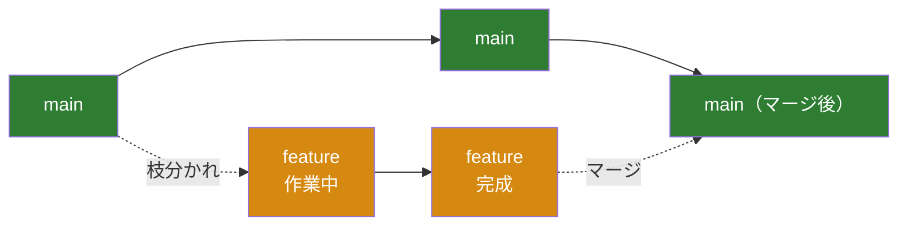
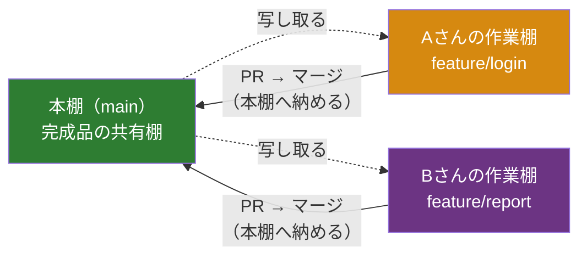
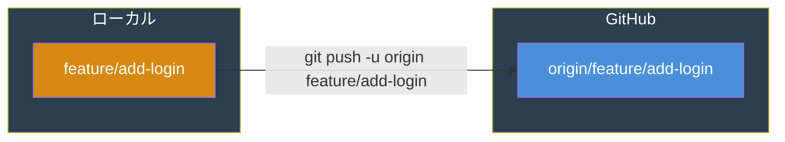
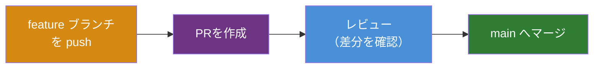
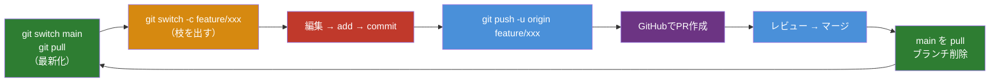

# 03. ブランチ・PR編 〜チームで安全に開発する〜

このドキュメントは [02_GitHub編](02_GitHub編.md) の続きです。
02編では、ローカルとGitHubをつないで **1本の流れ（`main`）** をアップロード／ダウンロードしました。
03編では、**ブランチ**で作業を枝分かれさせ、**プルリクエスト（PR）**でレビューを挟み、**コンフリクト（競合）**を解決する——つまり「**複数人・複数タスクを安全に並行させる**」方法を扱います。

> 💡 **このドキュメントの読み方**
> - 1人で使う分には02編までで十分です。チームで開発する、または作業を安全に分けたくなったらここを読みます
> - コマンドをド忘れした人 → [05_逆引きチートシート](05_逆引きチートシート.md) へ
> - エラーが出て困った人 → [04_トラブルシューティング編](04_トラブルシューティング編.md) へ

---

## 目次

1. [なぜブランチが必要か](#なぜブランチが必要か)
2. [ブランチとは](#ブランチとは)
3. [ブランチの基本操作](#ブランチの基本操作)
4. [ブランチをリモートへ上げる](#ブランチをリモートへ上げる)
5. [プルリクエスト（PR）を作る](#プルリクエストprを作る)
6. [レビューとマージ](#レビューとマージ)
7. [コンフリクト（競合）を解決する](#コンフリクト競合を解決する)
8. [実践フロー：ブランチ運用の一周](#実践フローブランチ運用の一周)
9. [まとめと次のステップ](#まとめと次のステップ)

---

## なぜブランチが必要か

これまでは `main` という1本の流れだけで作業してきました。しかし、`main` に直接編集を重ねていくと、こんな問題が起きます。

- **完成していない変更が本流に混ざる**：試しに書いたコードや書きかけの原稿が、`main` を壊してしまう
- **複数人が同じ流れを触って衝突する**：AさんとBさんが同時に `main` を編集すると、`push` がぶつかる
- **お試しがやりにくい**：「うまくいかなかったら元に戻す」を安全に試せない

**ブランチ**を使うと、`main` から**枝分かれした作業用の流れ**を作れます。作業はその枝の上で行い、完成してから `main` に合流（マージ）させます。こうすれば、**`main` は常に「動く・完成した状態」に保たれます**。



---

## ブランチとは

**ブランチ（branch＝枝）**は、その名の通り**履歴の枝分かれ**です。ある時点の `main` からコピーを取り、そこから独立して作業を進める「もう1本の作業ライン」だと考えてください。

- `main`（メインブランチ）… 完成した状態を保つ本流。通常ここは**直接編集しない**
- `feature/...` などの**作業ブランチ** … 1つのタスク専用の枝。ここで自由に編集・コミットする

各ブランチは独立しているので、作業ブランチで何をしても `main` には影響しません。そして「今どのブランチにいるか」を **`HEAD`** が指しています。`git switch` でブランチを切り替えると、作業ツリーの中身もそのブランチの内容に入れ替わります。

> 💡 **1タスク＝1ブランチ**が基本です。「ログイン機能の追加」「第3章の加筆」のように、**1つの目的ごとにブランチを分ける**と、後述のPRやレビューがきれいにまとまります。

### たとえ：倉庫で考えるブランチ

01編で、リポジトリを**書類を保管する「倉庫」**にたとえました。ブランチは、この倉庫の中に置かれた**棚**だと考えると分かりやすくなります。

| Git | 倉庫のたとえ |
|---|---|
| `main` | 全員が共有する**正式な棚（本棚）**。常に「完成品」だけを並べる |
| 作業ブランチ | 本棚の中身を**丸ごと写し取った、自分専用の作業棚** |
| そのブランチでの `commit` | 自分の作業棚に、書き直した書類の写しを並べていく |
| PR → マージ | 完成した書類を**本棚に納める申請と反映** |

大事なのは、作業棚は**本棚の写しから始まる独立した棚**なので、そこで何をしても本棚（`main`）は汚れない、という点です。だから安心して書きかけの書類を置いたり、失敗した写しを捨てたりできます。

### 複数人のときはどうなるか

倉庫のたとえは、**複数人での作業**でこそ効いてきます。メンバーはそれぞれ、本棚から**自分専用の作業棚を写し取って**並行して作業します。互いの作業棚は独立しているので、**他の人の手元を邪魔しません**。



完成したら、各自が自分の作業棚の書類を順番に本棚へ納めて（マージして）いきます。
ここで、AさんとBさんが「同じ書類の同じ箇所」を別々に書き換えていた場合、
**後から本棚へ納める人のときに「どちらの内容を正とするか決められない」状態になります。** 
これが後述の**コンフリクト（競合）** です。

> 💡 逆に言えば、**触る書類（ファイル）や箇所をタスクごとに分けておく**と、
> 本棚に納める順番が前後してもぶつかりません。これがコンフリクト予防の基本的な考え方です。

---

## ブランチの基本操作

作業ブランチを作って切り替えるところから始めます。

```bash
# 現在のブランチ一覧を見る（* が今いるブランチ）
git branch

# ブランチを作って、同時にそこへ切り替える
git switch -c feature/add-login

# （参考）古い書き方。同じ意味
git checkout -b feature/add-login
```

`git switch -c` の `-c`（create）は「新しく作って切り替える」という意味です。
すでにあるブランチへ移動するだけなら `-c` は不要です。

```bash
# 既存のブランチへ切り替える
git switch main
git switch feature/add-login

# 不要になったブランチを削除する（マージ済みのものだけ安全に消える）
git branch -d feature/add-login
```

作業ブランチに切り替えたら、あとは**01編の黄金フローと同じ**です。
「編集 → `git add` → `git commit`」を、このブランチの上で繰り返します。

> 💡 **ブランチ名の付け方**：厳密な決まりはありませんが、`種類/内容` の形が広く使われます。例：新機能なら `feature/add-login`、バグ修正なら `fix/typo-in-readme`。目的がひと目で分かる名前にします。

> ⚠️ 作業を始める前に、**`main` を最新にしてから枝分かれ**するのが安全です（`git switch main` → `git pull` → `git switch -c 新ブランチ`）。古い `main` から分岐すると、後でコンフリクトが起きやすくなります。

---

## ブランチをリモートへ上げる

作った作業ブランチは、ローカルにあるだけではチームに共有されません。02編の `push` で**リモートにも同じブランチを作り**ます。

```bash
# 初回：リモートに同名のブランチを作り、宛先を記憶させる
git push -u origin feature/add-login

# 2回目以降はこれだけでOK
git push
```

`-u`（`--set-upstream`）は02編と同じで、「このローカルブランチの写し先はリモートのこのブランチだ」と結び付けるオプションです。一度付ければ、以降は `git push` / `git pull` だけで、今いるブランチが同期されます。



> 💡 リモートに上げたブランチは、GitHubのリポジトリ画面のブランチ切り替えメニューから確認できます。これで、他のメンバーもあなたのブランチを見られるようになります。

---

## プルリクエスト（PR）を作る

**プルリクエスト（Pull Request、PR）**は、「自分の作業ブランチの変更を `main` に取り込んでください」という**依頼**です。ただの合流ではなく、**レビュー（変更内容の確認）を挟む入口**になります。



**PRの作成手順**

1. ブランチを `push` した後、GitHubのリポジトリ画面を開きます。上部に **「Compare & pull request」** ボタンが出るのでクリックします（出ない場合は **Pull requests** タブ → **New pull request**）。
2. **base**（取り込み先＝通常 `main` または`develop`）と **compare**（自分の作業ブランチ）が正しいか確認します。
3. **タイトル**と**説明**を書きます。「何を・なぜ変えたか」を簡潔に書くとレビューが早く進みます。
4. **Create pull request** をクリックします。

> **PR作成画面（Compare & pull request）**
> 
> base と compare を確認し、タイトル・説明を記入して作成する
> 
> 

> 💡 PRを作ると、以降その作業ブランチに `push` するたびに**変更が自動でPRに追加**されます。レビューの指摘を直したら、同じブランチで `add` → `commit` → `push` すればOKです。

---

## レビューとマージ

PRの画面では、**Files changed** タブで変更の差分（追加＝緑、削除＝赤）を確認できます。チーム開発では、ここで他のメンバーがコメントや承認（Approve）を行います。

問題がなければ、PR画面の **「Merge pull request」** ボタンで `main` に取り込みます。マージが済んだら、次の後片付けをします。

```bash
# 1. ローカルの main に戻る
git switch main

# 2. マージされた最新の main を取り込む
git pull

# 3. 役目を終えた作業ブランチを削除する（ローカル）
git branch -d feature/add-login

# 4. リモートの作業ブランチも削除する（GitHubのPR画面のボタンでも可）
git push origin --delete feature/add-login
```

> 💡 マージ後にブランチを消すのは、**散らかり防止**のためです。GitHubのPR画面にも、マージ後に **「Delete branch」** ボタンが出るので、そこから消しても構いません。

> 💡 次のタスクを始めるときは、また `main` を最新にしてから新しいブランチを切ります。この「**最新の `main` から枝を出す**」を守るのが、コンフリクトを減らす一番のコツです。

---

## コンフリクト（競合）を解決する

**コンフリクト（競合）**は、**同じファイルの同じ箇所を、2つの流れが別々に変更した**ときに起こります。Gitが「どちらを採用すべきか自動で判断できない」ため、あなたに解決を求めてきます。

### なぜ起きるのか

たとえば、共有リポジトリを元にAさんとBさんが別々に作業し、同じ行を違う内容に書き換えたとします。片方が先にマージした後、もう片方が `pull` や `merge` をすると、履歴が食い違ってコンフリクトになります。

> 💡 **予防が最善です。** 「1タスク＝1ブランチ」「作業前に `main` を `pull`」「触るファイルをタスクごとに分ける」を守ると、コンフリクトは大きく減ります。ただしLaTeXの原稿など、同じファイルを複数人で触る場面では起きやすいので、直し方を知っておきましょう。

### 発生したときの見え方

`git pull` や `git merge` の際に、次のようなメッセージが出ます。

```text
Auto-merging report.tex
CONFLICT (content): Merge conflict in report.tex
Automatic merge failed; fix conflicts and then commit the result.
```

`git status` を打つと、`Unmerged paths` として競合したファイルが表示されます。

### マーカーの読み方

競合したファイルを開くと、該当箇所が次のようなマーカーで囲まれています。

```text
<<<<<<< HEAD
自分（今いるブランチ）の変更内容
=======
取り込もうとした相手の変更内容
>>>>>>> origin/main
```

- `<<<<<<< HEAD` 〜 `=======` … **自分側**の内容
- `=======` 〜 `>>>>>>> ...` … **相手側**の内容

### 解決の手順

1. ファイルを開き、**どちらを残すか**（あるいは両方を活かして書き直すか）を決めます。
2. **マーカー3行（`<<<<<<<` / `=======` / `>>>>>>>`）を必ず削除**し、最終的に正しい状態にします。
3. 解決したファイルを `add` して、`commit` します。

```bash
# 解決したファイルを「解決済み」として登録する
git add report.tex

# コミットして競合の解決を確定する（メッセージは自動で用意される）
git commit
```

これで競合は解決です。複数ファイルで起きた場合は、すべてのファイルを直して `add` → `commit` します。

> 💡 **VS Codeを使うと簡単です。** 競合したファイルを開くと、`<<<<<<<` の箇所に **「Accept Current Change（自分側）／Accept Incoming Change（相手側）／Accept Both Changes（両方）」** というボタンが表示されます。クリックするだけでマーカーごと処理でき、手作業で消す必要がありません。処理後に `git add` → `git commit` するのは同じです。

> ⚠️ 途中で「やっぱりやめたい」ときは `git merge --abort` で、マージ開始前の状態に戻せます。慌てて壊す前に、まず落ち着いてこのコマンドを思い出してください。

---

## 実践フロー：ブランチ運用の一周

ここまでを1つの流れにまとめます。**この一周を繰り返す**のが、チーム開発の基本リズムです。



```bash
# 1. main を最新にする
git switch main
git pull

# 2. 作業ブランチを切る
git switch -c feature/add-login

# 3. 編集して記録する（01編の黄金フロー）
git add .
git commit -m "ログイン機能を追加"

# 4. リモートへ上げる
git push -u origin feature/add-login

# 5. GitHubでPRを作成 → レビュー → マージ（ブラウザで操作）

# 6. 後片付け
git switch main
git pull
git branch -d feature/add-login
```

---

## まとめと次のステップ

- **`main` は直接触らず**、タスクごとに**作業ブランチ**を切って編集する
- 作業ブランチは `git push -u origin ブランチ名` でリモートにも共有する
- **PR**は「`main` に取り込んでほしい」という依頼であり、**レビューの入口**
- マージ後は **`main` を `pull` → 済んだブランチを削除**して片付ける
- **コンフリクト**は同じ箇所の二重変更で起きる。マーカーを消して `add` → `commit` で解決
- 何より、**最新の `main` から枝を出す**ことがコンフリクト予防の要

これで、ローカル（01編）→ GitHub連携（02編）→ チーム開発（03編）の一通りが揃いました。日々の作業でコマンドを忘れたら [05_逆引きチートシート](05_逆引きチートシート.md) を、エラーやトラブルに出くわしたら [04_トラブルシューティング編](04_トラブルシューティング編.md) を、それぞれ辞書代わりに使ってください。
