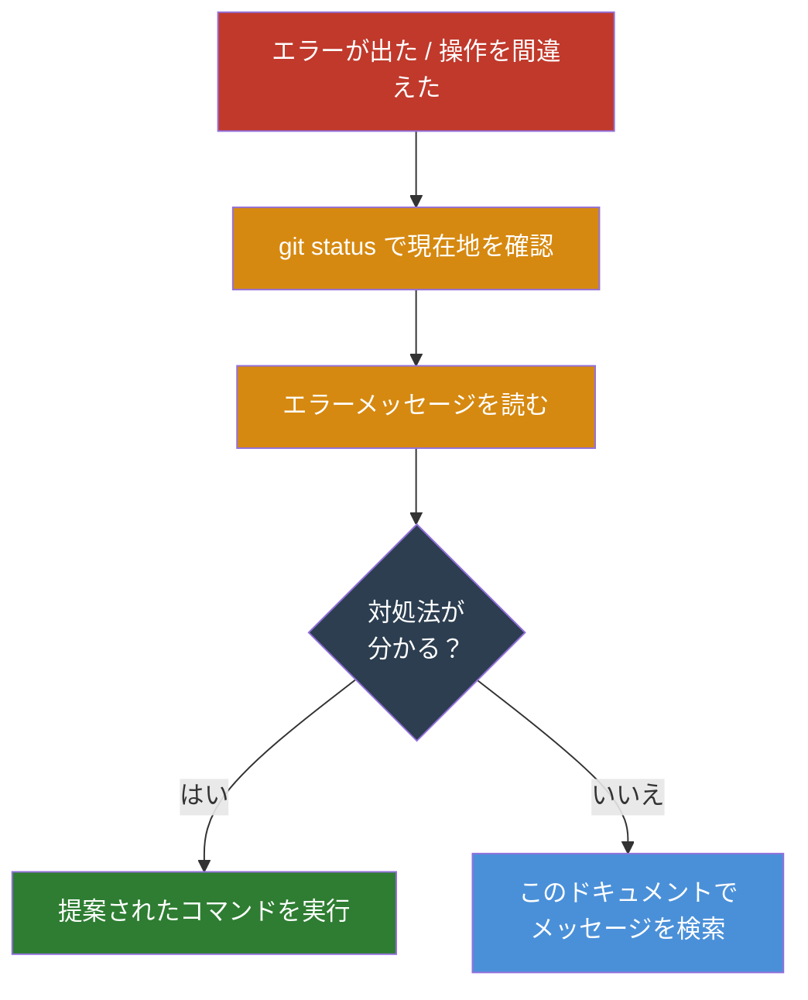

# 04. トラブルシューティング編 〜エラー・事故からの復旧〜

このドキュメントは、Gitを使っていて **エラーが出た・操作を間違えた** ときの対処をまとめた「困ったときの駆け込み寺」です。
01〜03編で基本の流れを学んだあと、実際に手を動かすと必ず何かにぶつかります。そのときにここを開いてください。

> 💡 **このドキュメントの読み方**
> - **エラーメッセージが出た** → [エラーメッセージ逆引き](#エラーメッセージ逆引き) で本文を検索（メッセージの一部で探す）
> - **操作を間違えた・元に戻したい** → [やり直し・取り消し](#やり直し取り消し) へ
> - **やらかした気がする** → [よくある事故と復旧](#よくある事故と復旧) へ
> - コマンドだけ手早く引きたい → [05_逆引きチートシート](05_逆引きチートシート.md) へ

---

## 目次

1. [トラブル対応の心得](#トラブル対応の心得)
2. [エラーメッセージ逆引き](#エラーメッセージ逆引き)
3. [やり直し・取り消し](#やり直し取り消し)
4. [コンフリクト（競合）で詰まったとき](#コンフリクト競合で詰まったとき)
5. [よくある事故と復旧](#よくある事故と復旧)
6. [まとめ](#まとめ)

---

## トラブル対応の心得

エラーが出ても、**慌てて次々コマンドを打つのが一番危険**です。まず次の3つを守ってください。

1. **まず `git status`**：今どのファイルがどのエリアにあるか、どのブランチにいるかが分かります。ほとんどのヒントはここに出ます。
2. **メッセージを読む**：Gitのエラーは、たいてい**次にやるべきことを英語で提案**してくれています（`use "git ..."` の形）。
3. **コミット済みなら基本は安全**：一度 `commit` した内容は履歴に残っており、多くの操作は後から取り戻せます。怖いのは「まだコミットしていない変更」を捨てる操作だけです。



---

## エラーメッセージ逆引き

出たメッセージの一部から、原因と対処を引けます。

| メッセージ（一部） | 主な原因 | 対処 |
|---|---|---|
| `remote origin already exists` | `origin` が既に登録済み | URLを変えたいなら `git remote set-url origin 新URL` |
| `Updates were rejected` / `non-fast-forward` | リモートに手元が知らない更新がある | 先に `git pull` してから `git push` |
| `Authentication failed` | HTTPSの認証切れ・トークン失効 | `gh auth login`（再ログイン）または トークン再発行 |
| `Permission denied (publickey)` | SSH鍵が未登録／認識されていない | 公開鍵をGitHubに登録、`ssh -T git@github.com` で確認 |
| `fatal: not a git repository` | Git管理下でない場所にいる | 正しいフォルダへ `cd`、または `git init` |
| `nothing to commit, working tree clean` | 記録すべき変更がない | 変更を保存したか確認。`git status` で状態確認 |
| `You are in 'detached HEAD' state` | 特定コミットに直接いる（ブランチ上でない） | `git switch -c 新ブランチ名` で拾う、または `git switch main` で戻る |
| `error: failed to push some refs` | 多くは push 拒否（上記 `non-fast-forward`） | `git pull` で最新を取り込んでから `git push` |

### push が拒否された（`Updates were rejected`）

最も多いトラブルです。**あなたが最後に取得して以降、リモート側が更新された**ときに起こります。


```bash
# 1. まず取り込む（このときコンフリクトが出ることがある → 次章へ）
git pull

# 2. 取り込めたら改めて上げる
git push
```

### 認証で弾かれた

HTTPSかSSHかで対処が分かれます。

```bash
# HTTPS（gh を使っている場合）：再ログインする
gh auth login
gh auth status   # 状態を確認

# SSH：鍵が使えているか確認する
ssh -T git@github.com
```

→ 認証の設定方法そのものは [02_GitHub編「認証を設定する」](02_GitHub編.md#認証を設定するhttps-と-ssh) を参照。

---

## やり直し・取り消し

> ⚠️ 取り消し系は状態を戻す操作です。**実行前に必ず `git status` で現在地を確認**してください。特に「まだコミットしていない変更を捨てる」操作は、元に戻せません。

| したいこと | コマンド | 危険度 |
|---|---|---|
| ステージングから下ろす（変更内容は残す） | `git restore --staged ファイル名` | 安全 |
| 作業ツリーの変更を捨てて最後のコミットに戻す | `git restore ファイル名` | ⚠️ 変更が消える |
| 直前のコミットメッセージを直す | `git commit --amend -m "新しいメモ"` | 注意※ |
| 直前のコミットに、入れ忘れたファイルを追加する | `git add 忘れファイル` → `git commit --amend --no-edit` | 注意※ |
| 公開済みのコミットを打ち消す（履歴は残す） | `git revert コミットID` | 安全 |

※ `--amend` は**コミットを作り直す**操作です。**まだ push していないコミット**にだけ使ってください。push 済みのものを `--amend` すると履歴がずれ、チームに影響します。

### `restore` と `revert` の違い（重要）

- **`git restore`**：**まだコミットしていない**手元の変更を捨てる。作業をなかったことにする。
- **`git revert`**：**すでにコミット（push）済み**の変更を、「打ち消す新しいコミット」を積んで無効化する。**履歴は消さず**に安全に取り消せるので、共有ブランチではこちらを使う。

```bash
# 例：直前のコミットを打ち消したい（公開済みでも安全）
git revert HEAD
```

> 💡 「間違えたコミットを歴史から抹消したい」と思っても、共有済みの履歴は**消さずに打ち消す（revert）**のが鉄則です。履歴を書き換える `reset --hard` はローカル専用・自己責任の最終手段と考えてください。

---

## コンフリクト（競合）で詰まったとき

コンフリクトの基本的な直し方は [03_ブランチ・PR編「コンフリクト（競合）を解決する」](03_ブランチ・PR編.md#コンフリクト競合を解決する) に詳しくあります。ここでは **「解決できずに詰まった／やめたい」** ときの逃げ道を補足します。

| 状況 | コマンド |
|---|---|
| マージ作業をやめて、開始前の状態に戻したい | `git merge --abort` |
| `pull` で始まった競合をやめたい | `git merge --abort`（pull は fetch + merge のため） |
| どのファイルが競合中か確認したい | `git status`（`Unmerged paths` を見る） |

```bash
# 泥沼化したら、まず落ち着いて開始前に戻す
git merge --abort

# 状態を確認して、もう一度ていねいにやり直す
git status
```

> ⚠️ 競合ファイルには `<<<<<<<` `=======` `>>>>>>>` の**マーカー3行**が入ります。**これを消し忘れたままコミットしない**でください。消し忘れるとコードや原稿にゴミが残ります。
> 💡 VS Codeなら、競合箇所の「Accept Current / Incoming / Both Changes」ボタンでマーカーごと安全に処理できます。

---

## よくある事故と復旧

### 間違ったブランチで作業してしまった

**まだコミットしていない**なら、変更を持ったまま正しいブランチへ移れます。

```bash
# 今の変更を持ったまま、正しいブランチへ切り替える
git switch 正しいブランチ名
```

`main` で誤ってコミットまでしてしまった場合は、作業ブランチを切って続け、`main` はローカルで巻き戻す方法があります。判断に迷うときは無理に操作せず、状態（`git status` / `git log --oneline`）を控えてから対処してください。

### 秘密情報（パスワード・APIキー）をコミットしてしまった

> ⚠️ **push してしまった場合、その秘密情報は「漏れた」ものとして扱います。** 履歴から消す以前に、まず対処が必要です。

1. **まず鍵・トークンを無効化して再発行する**（これが最優先。消しても取得された可能性は消えない）
2. 該当ファイルを [`.gitignore`](01_Git編.md#gitignore記録したくないファイルを除外する) に追加し、今後コミットされないようにする
3. 履歴からの完全削除は影響が大きいため、チームや管理者と相談して対応する

### 大きなファイルを上げてしまった／リポジトリが重い

GitHubにはアップロード容量の上限があります。ビルド成果物や大容量データは、そもそもコミットしないのが基本です。

- 生成し直せるファイル・大容量データは [`.gitignore`](01_Git編.md#gitignore記録したくないファイルを除外する) で除外する
- 既にコミット済みのものは、`.gitignore` に足すだけでは消えません（[01編の注意書き](01_Git編.md#gitignore記録したくないファイルを除外する)参照）。対処が必要なら管理者に相談してください

### コミットしたはずの変更が push されない

`push` は**コミット済みの内容だけ**を送ります。「保存したのに反映されない」ときは、`add` → `commit` を忘れていないか確認します。

```bash
git status                    # 未コミットの変更が残っていないか確認
git add . && git commit -m "メモ"
git push
```

---

## まとめ

- **困ったらまず `git status`**。エラーメッセージは次の一手を教えてくれる
- **コミット済みは基本安全**。怖いのは未コミットの変更を捨てる操作だけ
- push 拒否は **`pull` してから `push`**
- 共有済みの取り消しは、履歴を消す `reset` ではなく**打ち消す `revert`**
- 泥沼化した競合は **`git merge --abort`** で開始前に戻れる
- 秘密情報の流出は、消す前に**まず鍵の無効化・再発行**

コマンドだけ手早く引きたいときは [05_逆引きチートシート](05_逆引きチートシート.md) を、各操作の背景を知りたいときは 01〜03編の本文を参照してください。

- [01_Git編](01_Git編.md)：自分のPCの中でGitを使う
- [02_GitHub編](02_GitHub編.md)：GitHubとつないで共有する
- [03_ブランチ・PR編](03_ブランチ・PR編.md)：チームで安全に開発する
- [05_逆引きチートシート](05_逆引きチートシート.md)：コマンドを「〜したい」から引く
