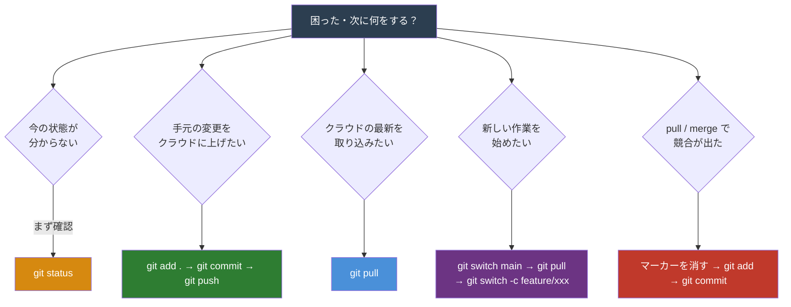

# 05. 逆引きチートシート 〜「〜したい」からコマンドを引く〜

このドキュメントは、01〜03編で登場したコマンドを **「〜したい → このコマンド」** の形で引けるようにまとめた辞書です。
使い方や背景をしっかり知りたいときは、各行のリンク先（01〜03編）を参照してください。

> 💡 **このドキュメントの読み方**
> - **やりたいことが決まっている** → 下の目次から該当セクションへ飛び、表の左列で探す
> - **意味や背景を知りたい** → 各セクション末尾のリンクから元の解説（01〜03編）へ
> - **迷ったらまず `git status`**：今どのファイルがどのエリアにあるかが分かり、次の一手が見えます

---

## 目次

1. [最初の設定（1度だけ）](#最初の設定1度だけ)
2. [変更を記録する（黄金フロー）](#変更を記録する黄金フロー)
3. [状態・履歴を確認する](#状態履歴を確認する)
4. [認証を設定する（GitHub連携の準備）](#認証を設定するgithub連携の準備)
5. [リモートとつなぐ・同期する](#リモートとつなぐ同期する)
6. [ブランチを操作する](#ブランチを操作する)
7. [プルリクエスト（PR）とマージ後の後片付け](#プルリクエストprとマージ後の後片付け)
8. [コンフリクト（競合）を解決する](#コンフリクト競合を解決する)
9. [やり直し・取り消し](#やり直し取り消し)
10. [困ったときのフローチャート](#困ったときのフローチャート)

---

## 最初の設定（1度だけ）

| したいこと | コマンド |
|---|---|
| 名前を登録する | `git config --global user.name "your-name"` |
| メールアドレスを登録する | `git config --global user.email "you@example.com"` |
| 設定内容を確認する | `git config --global --list` |
| 新規リポジトリの初期ブランチ名を `main` にする | `git config --global init.defaultBranch main` |
| Gitのバージョンを確認する | `git --version` |

→ 詳しくは [01_Git編「最初の設定」](01_Git編.md#最初の設定)

---

## 変更を記録する（黄金フロー）

**編集 → `add` → `commit`** の3ステップが基本です。

| したいこと | コマンド |
|---|---|
| 新しいフォルダをリポジトリにする | `git init` |
| 変更した1ファイルをステージングに追加する | `git add ファイル名` |
| 変更した全ファイルをステージングに追加する | `git add .` |
| コミット（セーブポイント）を作る | `git commit -m "変更内容のメモ"` |
| ステージング＋コミットをまとめて行う（追跡済みファイルのみ） | `git commit -am "メモ"` |

→ 詳しくは [01_Git編「【実践】はじめてのコミット」](01_Git編.md#実践はじめてのコミット)

> 💡 `git add .` の `.`（ドット）は「今いるフォルダ以下のすべての変更」という意味です。
> ⚠️ `push` は**コミット済みの内容だけ**を送ります。手元の編集を反映したいときは、必ず先に `add` → `commit` します。

---

## 状態・履歴を確認する

| したいこと | コマンド |
|---|---|
| どのファイルが変更され、どのエリアにあるか見る | `git status` |
| コミット履歴を見る | `git log` |
| 履歴を1行ずつ簡潔に見る | `git log --oneline` |
| まだステージングしていない変更の中身を見る | `git diff` |
| ステージング済みの変更の中身を見る | `git diff --staged` |
| リモートの登録内容を確認する | `git remote -v` |
| いまのブランチの「送り先」を確認する | `git branch -vv` |

→ 詳しくは [01_Git編「状態を確認するコマンド」](01_Git編.md#状態を確認するコマンド)

> 💡 `git log` の表示は `q` キーで終了します。

---

## 認証を設定する（GitHub連携の準備）

`push` する前に、**HTTPS か SSH のどちらか一方**を1度だけ設定します。

**HTTPS（GitHub CLI を使う・おすすめ）**

| したいこと | コマンド |
|---|---|
| `gh` がインストール済みか確認する | `gh --version` |
| `gh` をインストールする（Mac / Homebrew） | `brew install gh` |
| `gh` をインストールする（Linux / apt） | `sudo apt install gh` |
| GitHubにログインする | `gh auth login` |
| ログイン状態を確認する | `gh auth status` |
| 権限（スコープ）を追加する | `gh auth refresh -s スコープ名` |

**SSH鍵**

| したいこと | コマンド |
|---|---|
| 鍵ペアを作る | `ssh-keygen -t ed25519 -C "you@example.com"` |
| 公開鍵をコピーする（Mac） | `pbcopy < ~/.ssh/id_ed25519.pub` |
| 公開鍵をコピーする（Windows / Git Bash） | `cat ~/.ssh/id_ed25519.pub \| clip` |
| 公開鍵を表示する（Linux） | `cat ~/.ssh/id_ed25519.pub` |
| GitHubへの接続を確認する | `ssh -T git@github.com` |

→ 詳しくは [02_GitHub編「認証を設定する（HTTPS と SSH）」](02_GitHub編.md#認証を設定するhttps-と-ssh)

> ⚠️ 秘密鍵（`.pub` が付かない方）は絶対に他人に渡さないでください。GitHubに登録するのは公開鍵（`.pub`）だけです。

---

## リモートとつなぐ・同期する

| したいこと | コマンド |
|---|---|
| GitHubのリポジトリを丸ごと複製する | `git clone URL` |
| 手元のリポジトリにリモートを登録する | `git remote add origin URL` |
| リモートのURLを付け替える | `git remote set-url origin 新しいURL` |
| ブランチ名を `main` に統一する | `git branch -M main` |
| 初回のアップロード（送り先を覚えさせる） | `git push -u origin main` |
| 2回目以降のアップロード | `git push` |
| リモートの最新を取得して手元に反映する | `git pull` |
| リモートの最新を取得だけする（反映しない） | `git fetch` |
| 取得済みの内容を手元に統合する | `git merge origin/main` |

→ 詳しくは [02_GitHub編「ローカルとリモートをつなぐ」](02_GitHub編.md#ローカルとリモートをつなぐ)

> 💡 **始めに `pull`、終わりに `push`** を習慣にすると、コンフリクトが起きにくくなります。

---

## ブランチを操作する

| したいこと | コマンド |
|---|---|
| ブランチ一覧を見る（`*` が今いるブランチ） | `git branch` |
| ブランチを作って同時に切り替える | `git switch -c feature/xxx` |
| （古い書き方）作って切り替える | `git checkout -b feature/xxx` |
| 既存のブランチへ切り替える | `git switch ブランチ名` |
| 作業ブランチをリモートへ上げる（初回） | `git push -u origin feature/xxx` |
| ローカルのブランチを削除する（マージ済みのみ安全に） | `git branch -d feature/xxx` |
| リモートのブランチを削除する | `git push origin --delete feature/xxx` |

→ 詳しくは [03_ブランチ・PR編「ブランチの基本操作」](03_ブランチ・PR編.md#ブランチの基本操作)

> ⚠️ 作業を始める前に、**`main` を最新にしてから枝分かれ**するのが安全です（`git switch main` → `git pull` → `git switch -c 新ブランチ`）。

---

## プルリクエスト（PR）とマージ後の後片付け

PRの作成・レビュー・マージは**GitHubの画面（ブラウザ）で操作**します。マージ後の後片付けはコマンドで行います。

| したいこと | コマンド／操作 |
|---|---|
| PRを作る | GitHubの「Compare & pull request」→ base/compare を確認 → 作成 |
| PRに変更を追加する | 同じブランチで `add` → `commit` → `push` |
| マージ後にローカルの `main` を最新化する | `git switch main` → `git pull` |
| マージ済みのローカルブランチを消す | `git branch -d feature/xxx` |
| マージ済みのリモートブランチを消す | `git push origin --delete feature/xxx` |

→ 詳しくは [03_ブランチ・PR編「プルリクエスト（PR）を作る」](03_ブランチ・PR編.md#プルリクエストprを作る)

---

## コンフリクト（競合）を解決する

同じ箇所を別々に変更したとき、`pull` / `merge` で発生します。

| したいこと | コマンド |
|---|---|
| どのファイルが競合したか確認する | `git status` |
| 解決したファイルを「解決済み」として登録する | `git add ファイル名` |
| 解決を確定する（メッセージは自動用意） | `git commit` |
| マージをやめて開始前の状態に戻す | `git merge --abort` |

**解決の手順**：ファイルを開き、マーカー3行（`<<<<<<<` / `=======` / `>>>>>>>`）を削除して正しい状態にする → `add` → `commit`。

→ 詳しくは [03_ブランチ・PR編「コンフリクト（競合）を解決する」](03_ブランチ・PR編.md#コンフリクト競合を解決する)

> 💡 VS Codeなら、競合箇所の「Accept Current / Incoming / Both Changes」ボタンでマーカーごと処理できます。

---

## やり直し・取り消し

> ⚠️ 取り消し系は状態を戻す操作です。**不安なときはまず `git status` で現在地を確認**してから使ってください。

| したいこと | コマンド |
|---|---|
| 作業ツリーの変更を捨てて最後のコミットに戻す（1ファイル） | `git restore ファイル名` |
| ステージングから下ろす（変更内容は残す） | `git restore --staged ファイル名` |
| 直前のコミットメッセージを修正する | `git commit --amend -m "新しいメモ"` |
| マージ作業を中止して開始前に戻す | `git merge --abort` |
| 公開済みのコミットを打ち消す（履歴は残す） | `git revert コミットID` |

→ 各操作の使い分けや事故からの復旧は [04_トラブルシューティング編](04_トラブルシューティング編.md) を参照

> 💡 `git restore` は**まだコミットしていない**変更を捨てるコマンドです。捨てた変更は元に戻せないので注意してください。

---

## 困ったときのフローチャート

---

各コマンドの「なぜそうするのか」は、01〜03編の本文で図とともに説明しています。手が止まったら、まずこのチートシートで当たりをつけ、詳しく知りたくなったらリンク先へ戻ってください。

- [01_Git編](01_Git編.md)：自分のPCの中でGitを使う
- [02_GitHub編](02_GitHub編.md)：GitHubとつないで共有する
- [03_ブランチ・PR編](03_ブランチ・PR編.md)：チームで安全に開発する
- [04_トラブルシューティング編](04_トラブルシューティング編.md)：エラー・事故からの復旧
